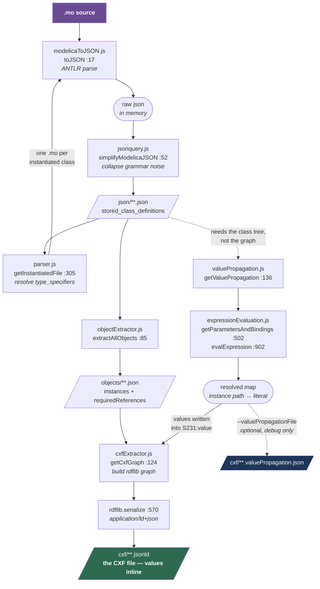

> __Working document.__ This is the detailed version, with implementation specifics, file and line
> references, and rationale. The short version for review is `modjson_proposal.md`.

There are certain missing features and unintended behaviors that impede the correct translation of a Modelica file into a cxf file

This document proposes changes to `modelica-json` to correct these issues and return a fully connected and evluated cxf file that mimics the inputted Modelica file

The guiding principle: **everything that requires Modelica semantics happens here.** Expression
evaluation, modification propagation, `final`/`each`/redeclare, conditional components and array
expansion all need the full AST and MODELICAPATH class lookup. The Java translator has neither.
Anything left unevaluated in the CXF forces every downstream consumer to implement a second,
weaker Modelica evaluator — and two evaluators can disagree.

---

### 1. Value Propagation

#### 1.1 Two files, not one

`value_prop.json` today mixes three different things. It has to be split:

| | What | Who writes it | Example |
|---|---|---|---|
| **Input** | Free parameters with no value anywhere in the model | The user, once per configuration | `nZon = 1` |
| **Output** | Every value derived from those | Generated | `conNSel.k = 1`, `zonPri.instantiate = false` |

Everything currently in the `String` section of `value_prop.json` (`"conNSel.k": "nZon"`,
`"{i for i in 1:nZon}"`, `"fill(0.00001,nZon)"`) is neither — it is the _unresolved_ list, i.e. the
bug being fixed. It disappears once evaluation runs.

#### 1.2 Supplying the input

Two ways, same effect:

```sh
node app.js -f HeatingOrCooling.mo -o cxf --parameterValues config.json
node app.js -f HeatingOrCooling.mo -o cxf --parameter nZon=1 --parameter airConMod=false
```

`config.json` is flat — no type grouping, since the declared type is already known from the AST:

```json
{
  "nZon": 1,
  "nSel": 1,
  "airConMod": false,
  "zonConVar": "Variant_3",
  "dTShe": 2,
  "dTReb": 2,
  "dTSheThr": 1,
  "dTSheHys": 0.5,
  "PBuiHys": 1000,
  "PBuiThrCon": 50000,
  "TResInt": 0.5,
  "samPerSetCha": 3600
}
```

CLI overrides file, so a swept parameter can be varied without editing the file. Values are coerced
and __validated against the declaration__: `nZon="x"` fails as not an Integer, `nZon=0` fails against
`min=1` (`HeatingOrCooling.mo:49`), `zonConVar="Variant_9"` fails as not a literal of the
enumeration. Fail at parse time with the parameter named, rather than producing a wrong CXF.

#### 1.3 Structural vs tuning parameters

Free parameters divide into two kinds, and only one of them is recoverable downstream:

- **Structural** — the value changes the *topology* of the generated file: how many blocks exist,
   which blocks exist, how they are wired. It must be known at translation time. There is no way to
   patch it afterwards in Eikon.
- **Tuning** — the value ends up as a number inside a constant block. The topology is the same
   whatever it is, so it can in principle be edited after the fact.

A parameter is structural iff it reaches, directly or transitively through other parameter bindings,
any of:

1. an array dimension or subscript — `TCurZon[nZon]`
2. a conditional component guard — `if nZon > 1`, `if airConMod`
3. the count argument of a shaping function — `fill(x, nZon)`, `nout=nZon`
4. a `redeclare` or conditional type
5. a `for`-equation range in a `connect` equation

**The closure must be computed over the whole instance tree, not the top-level file.** In
`HeatingOrCooling.mo`, `airConMod` appears only as a value — `fill(airConMod, nZon)` at `:147`,
`final k=airConMod` — and looks like pure tuning. But `ZonePrioritization.mo:42,47` uses it to guard
`selSmaDTZon` vs `selLarDTZon`, so it decides which of two different blocks exists. It is structural,
and nothing in the top-level file says so.

The converse trap: `nSel` is an integer named like a count, but `:160` binds it to `final k=nSel` on a
constant block which `:231` connects into `zonPri.nSel` as a *signal*. It is tuning.

For `HeatingOrCooling.mo`: **structural** = `nZon`, `zonConVar`, `airConMod`; **tuning** = `nSel`,
`dTShe`, `dTReb`, `dTSheThr`, `dTSheHys`, `PBuiHys`, `PBuiThrCon`, `TResInt`, `samPerSetCha`.

Note that structural does not mean important. `airConMod` selects heating versus cooling — the
largest semantic switch in the sequence — and qualifies as structural only incidentally, two files
away. The classification records what cannot be fixed later, not what matters most.

**Consequence.** Both kinds are defaulted when not supplied (§1.4), so neither blocks a run. The
classification drives how loudly a default is reported: a defaulted tuning value is a wrong number in
a block that exists, and can be corrected in Eikon; a defaulted structural value silently produces a
*different sequence*, and can only be corrected by re-running the translation.

Tuning parameters should still be accepted in the input rather than always deferred to Eikon:

- `fill(dTShe, nZon)` at `nZon=12` is twelve constant blocks needing the same edit.
- after `--flattenArrays` the block is named `zonCon_7.conDTShe.k`; the correspondence to the
   Modelica parameter name is gone.
- `dTShe` declares `min=0`. Supplied here it is checkable; typed into Eikon it is not.

#### 1.4 Defaults, and recording them

Every free parameter with no supplied value gets a default, so the run always produces output and
`S231:value` is always a literal. This is what removes the need for an unset marker in §1.3: no
downstream consumer ever encounters an unevaluated Modelica expression.

**Defaults are read out of the declaration.** Modelica already has an attribute meaning "a reasonable
guess" — `start` — and bounds that constrain the legal range. The precedence is:

1. **explicitly declared `start`** — `PBuiHys(min=0, start=1)`, `PBuiThrCon(min=0, start=1)` → `1`
2. **explicitly declared `min`** (or `max`, if only `max` is given) — `nZon(min=1)`, `nSel(min=1)` → `1`
3. __first literal__, for enumerations — `zonConVar` → `Variant_1`
4. **the language's own default `start`** — `Real` → `0.0`, `Integer` → `0`, `Boolean` → `false`,
   `String` → `""`

Nothing here is invented by this tool: every default traces to either the source file or the Modelica
specification. `airConMod` is the only one of the twelve that reaches rule 4, and it therefore
defaults to `false` — not because cooling is likelier, but because that is what the spec says an
unset `Boolean` is.

> **Implementation trap.** Rules 1 and 2 must read *explicitly written* modifications, not resolved
> attribute values. The predefined types already declare all of these — `type Real` has
> `start = 0.0`, `min = -inf`, `max = +inf` — so querying the effective attribute set makes rule 1
> fire on every parameter and makes rule 2 default things to negative infinity. The distinction is
> available in the AST: the modification list on the component declaration is what
> `cxfExtractor.js` already reads for `min`/`max`/`unit`/`quantity`.

Two consequences worth accepting deliberately:

- `min` is a bound, not a sensible value. `samPerSetCha(min=0, unit="s")` defaults to a sampling
   period of zero, which is degenerate. Still better than an arbitrary constant, and the record below
   covers the residual risk.
- An `Integer` count with no declared `min` falls to rule 4 and defaults to `0`, not `1`. In practice
   counts declare their bound — `nZon` and `nSel` both do — so rule 2 catches them. Where it does
   apply, `0` is the safer answer: zero blocks is visibly broken and gets noticed, whereas `1`
   produces a plausible single-zone sequence that can ship wrong.

**Every defaulted value is written into the output, not merely logged.** A warning printed at
`mo → cxf` is invisible by the time anyone is looking at the sequence in Eikon, three stages and one
tool later — the artifact travels, the log does not. So `<Class>.valuePropagation.json` carries:

```json
"defaulted": [
  { "name": "nZon",      "value": 1,     "structural": true,  "source": "min" },
  { "name": "airConMod", "value": false, "structural": true,  "source": "language-default" },
  { "name": "dTShe",     "value": 0,     "structural": false, "source": "min" }
]
```

`source` names which rule supplied the value, so `language-default` on a structural parameter — the
case with no support in the source at all — is greppable.

Defaulting is acceptable because the assumption is auditable downstream, not because anyone is
expected to have read stderr. Consumers can surface "generated with 2 assumed structural values" at
the point where it matters.

Structural defaults are reported more prominently than tuning ones, because they are not recoverable:
a wrong `dTShe` is a wrong number in a block that exists, whereas `nZon=1` instead of `12` is a
different sequence — `enaOneZon` exists only at `nZon == 1`, `zonPri` only at `nZon > 1`. No edit in
Eikon reaches that; it requires re-running the translation.

`--strictParameters` disables defaulting entirely and makes any missing value an error, for CI and
production runs where a silent assumption should not pass.

Where a default is genuinely sensible for every user of a block, it still belongs in the Modelica
source — `parameter Integer nZon = 1` resolves today with no new machinery and is visible to every
other Modelica tool.

#### 1.5 Discovering what must be defined

```sh
node app.js -f HeatingOrCooling.mo --listParameters
```

emits the input skeleton **with defaults pre-filled** — run it, edit it, feed it back via
`--parameterValues`. Pre-filling turns "remember to define twelve things" into "fill in this form",
which is a far weaker demand on memory than any warning:

```json
{
  "nZon": 1,            // structural — from min
  "airConMod": false,   // structural — language default, no basis in the source
  "zonConVar": "Variant_1",
  "dTShe": 0,           // tuning — from min
  "...": "..."
}
```

A parameter is **free** — i.e. a candidate for the input file — iff **all** of:

1. declared `parameter` (not `constant`, not a variable), and
2. no binding in its own declaration — note `nZon(min=1)` is an *attribute*, still free, and
3. not `final`, and
4. not supplied by an enclosing modification (so this only ever applies to the top-level class).

This is Modelica's own definition of a tunable — the same set Dymola shows in its parameter dialog.
No heuristics. For `HeatingOrCooling.mo` it is all twelve top-level parameters: `dTShe`, `dTReb`,
`dTSheThr`, `dTSheHys`, `PBuiHys`, `PBuiThrCon`, `TResInt`, `samPerSetCha`, `airConMod`, `nZon`,
`nSel`, `zonConVar`. The block is written as a reusable template and commits to nothing.

Rule 2 is where the check earns its keep: `dTShe(min=0, unit="K")` and `nZon(min=1)` *look* bound,
but everything inside the parentheses is an attribute. A binding is `= value` outside them. Reading
the declaration by eye gets this wrong; reading the AST does not.

Whether a free parameter is *required* is then the structural test of §1.3. `--listParameters` should
report both — name, declared type, unit, `min`/`max`, description, and `structural: true|false` — so
the skeleton shows at a glance what must be answered now and what can wait.

The source also says _when_ a parameter is relevant. `PBuiThrCon` carries
`annotation(Dialog(enable = zonConVar == ...Variant_3))` (`HeatingOrCooling.mo:37`), so at
`zonConVar=Variant_1` it is inert and must not be demanded. `--listParameters` should report this
condition alongside each entry, and the required-value check should respect it.

#### 1.6 Output — one self-contained file

**One `.mo` in, one `.jsonld` out. That file carries everything a consumer needs and references
nothing outside itself.**

This is the acceptance criterion for the whole proposal, and it is stricter than "resolved values
go inline". A file that inlines every value but still points at nine other files for its block
definitions has not met it. Two things follow.

**(a) Values are `S231:value` literals in the graph, not a second file.** A second file is a second
thing to name, version, hand off and keep matched to the right CXF — and any consumer that receives
only the `.jsonld` silently gets an unevaluated model, the exact failure this proposal exists to
remove. Same for the `defaulted` record of §1.4: it goes on the parameter nodes as triples
(`S231:value` plus a marker for which rule supplied it), so the audit travels with the artifact.
`<path>.instantiate` for conditional components — true only when the component's own condition *and*
every ancestor's condition hold — is likewise a triple on the instance node.

**(b) The CXF is one expanded instance tree, not a class library.** Today `cxfExtractor.js` writes
one `.jsonld` per class — 10 for `HeatingOrCooling` — each describing its own components one level
deep, with sub-blocks present only as a type reference (`cxfPrefix(typeSpecifier)`) resolved by
reading another file. That fails the criterion twice over:

- it is a dangling reference — the top-level file does not contain the definition of `zonQua`, so it
   cannot be read alone;
- a class node cannot hold per-instance values anyway. `HeatingOrCooling` instantiates
   `SetpointChange` three times, and `setChaPre.incSetCha` resolves to `false` while
   `setChaShe`/`setChaReb` resolve to `true`. One shared node, three answers.

Both are fixed by the same move: emit every component at its full instance path.
`ex:HeatingOrCooling.setChaPre.incSetCha` and `ex:HeatingOrCooling.setChaShe.incSetCha` become
distinct nodes with their own literals, and the contents of every sub-block are expanded into the
tree rather than referred to. The original class of each instance is still recorded as a type
annotation for traceability, but nothing has to be fetched to interpret the file. Leaves of the tree
are CDL elementary blocks, whose types are standard ASHRAE 231P vocabulary — a name, not a file
reference — so the expansion terminates.

This is the same expansion `--flattenArrays` already requires (§2), which is why it is one change and
not two.

The per-class files can keep being written as a debugging intermediate, in the way `json/` and
`objects/` already are. What changes is that nothing downstream reads them.

**Debug output.** `--valuePropagationFile` writes `<Class>.valuePropagation.json` — the resolved set
keyed by instance path, grouped by category (`Real`, `Integer`, `Boolean`, `String`, `Enumerated`),
which is the shape the Java side parses today — plus the `unresolved` list, which is the more useful
half when something has not evaluated. Off by default, no part of the contract, and no consumer
should ever be built against it. It exists so the current Java path has a transition and so a bad
run can be diagnosed without re-reading the graph.

---

### 2. Array Flattening

`--flattenArrays` (off by default) expands every array component into N scalar components named
`<name>_1 … <name>_N`, with connections rewritten to match.

__Why here and not in `Translator.java`.__ Expansion needs array dimensions resolved (§1), the
connection graph, and slice-connection semantics (`connect(a.y, b[:].u)`, `connect(a[i].y, b[i].u)`
inside a `for` equation). That is all AST work. Keeping `rp_template` in Java means maintaining a
second expansion implementation against a lossier input.

**Why behind a flag.** `S231:isArray` / `S231:numberDimensions` / `S231:sizeOfDimensions` are
standard ASHRAE 231P vocabulary. A flattened file is no longer valid 231P, and the transform is
one-way — round-tripping gives twelve blocks instead of `blk[12]`. Default output stays standard;
the Eikon path opts in.

Values are inline in both cases (§1.6) — the flag only decides whether `blk[12]` stays one array
component or becomes twelve scalar ones. Both outputs are instance-rooted; flattening is a further
transform on the same tree, not the thing that makes values representable.

Details to settle before implementing:

- Indices are __1-based__, matching Modelica: `blk_1 … blk_N`, never `blk_0`.
- `_N` can collide with a real component already named `blk_1`. Detect and fail rather than silently
   merging two blocks.
- Components with `instantiate = false` are dropped entirely, along with their connections.
- Multi-dimensional arrays: `blk_1_2`, or flatten row-major to a single index? Only 1-D appears in
   the current model, so this can be deferred — but decide before something 2-D shows up.

---

### 3. Already implemented

Working in the tree, not yet committed:

- `lib/valuePropagation.js` — the resolver of §1, wired into `-o cxf` in `app.js`. Walks the
   instance tree itself rather than relying on `documentation`, which omits elementary blocks and I/O
   connectors — exactly the components that most need `instantiate`. **It currently runs after the
   CXF and writes its own file; §1.6 moves it before the writer and makes that file optional.**
- `lib/expressionEvaluation.js` — array comprehensions (`{i for i in 1:nVal}`) now evaluate; two
   pre-existing crashes fixed (a one-operand `not`, and `new RegExp(path.sep)`, which is invalid on
   Windows); `getClassDefinition` now accepts the `stored_class_definitions` shape the parser actually
   emits, without which every sub-block lookup returned `null`.
- `lib/cxfExtractor.js` — `fill(...)` attributes on `min`/`max`/`unit`/`quantity` are resolved
   instead of silently dropped.

Verified on the Validation model (which binds `nZon=1, nSel=1, airConMod=false,
zonConVar=Variant_2`): 227 resolved, 37 unresolved, no regressions against the test suite.

### 4. Open questions

- __Enumeration representation.__ `value_prop.json` writes `zonConVar: 3` as an Integer ordinal;
   modelica-json's evaluator resolves enumeration literals to fully-qualified strings
   (`Buildings...ZoneControlVariant.Variant_3`). The input format should accept the readable name;
   the output format needs one canonical choice, agreed with whatever consumes it.
- **Structural classification is not implemented.** `collectComponents` already walks the instance
   tree, which is the hard part, but nothing yet records which expressions sit in dimension or guard
   position, and nothing computes the transitive closure back to the free parameters. Until it exists,
   every free parameter has to be treated as required.
- **Unresolved entries.** Currently logged and omitted from the output entirely. Under §1.4 they
   should instead be defaulted and recorded on the parameter node — neither the defaulting nor the
   record exists yet.
- **Instance-rooted CXF is not implemented.** §1.6 requires the top-level file to expand nested
   components to their full instance path, so `setChaPre.incSetCha` and `setChaShe.incSetCha` are
   separate nodes. `cxfExtractor.js` writes one class file per class, one level deep. This is the
   prerequisite for inlining values, and it is shared with array flattening (§2).
- **Does anything currently rely on the per-class CXF files?** Under §1.6 they become a debugging
   intermediate that nothing downstream reads. If some consumer today treats the output as a reusable
   class library rather than one instantiated sequence, the expanded single file is not a drop-in
   replacement for it. Worth confirming with whoever consumes the CXF before the switch.
- **Where does the expansion stop?** Leaves are CDL elementary blocks, typed by standard 231P
   vocabulary, so the recursion terminates. But a sequence that instantiates a non-CDL, non-elementary
   class from outside the translated library would expand into it too — confirm that is wanted, or
   define the boundary.
- **What counts as "reported prominently"** for a defaulted structural value. The `defaulted` block
   makes it available; whether the Java translator or the Eikon add-on surfaces it, and how, is a
   decision for those layers.
- **Remaining evaluator gaps.** `end` in subscripts, `ones()`, package constants, and enumeration
   literals bound to Integer-typed parameters are still unresolved. `timTab.timeRange` stringifies to
   the literal `{ terms: [Array] }` — a `stringifyExpression` defect.
- `Buildings/.../ZoneTemperatureSetpointChange/HeatingOrCooling.mo` in the local library has an empty
   `within ;` clause, which blocks class lookup for that block. Needs restoring upstream.

---

### 5. The Modelica → CXF path, end to end

This section traces one `-o cxf` run: which file and function touches the source, what each hands
to the next, and how a line of Modelica ends up as a triple in the `.jsonld`. It covers **only**
the `modelica → cxf` path (`-o cxf`, default `-m cdl`). The `raw-json`, `json`, `semantic`, `doc`
and `--cxf-core` outputs branch off earlier and are not shown.

#### 5.1 The pipe, at a glance

Five transformations, each writing its artifact to disk before the next reads it:

```ini
  HeatingOrCooling.mo                       ← Modelica source
          │
          │  lib/modelicaToJSON.js : toJSON (:17)
          │  ANTLR lexer → parser → Stored_definitionVisitor
          ▼
  raw json  (parse tree, in memory)         ← every token, deeply nested
          │
          │  lib/jsonquery.js : simplifyModelicaJSON (:52)
          ▼
  <out>/json/**/HeatingOrCooling.json       ← collapsed grammar noise
          │                                    key: stored_class_definitions
          │
          │  lib/objectExtractor.js : extractAllObjects (:85)
          ▼
  <out>/objects/**/HeatingOrCooling.json    ← flat instance map + connections
          │                                    keys: instances, requiredReferences
          │
          │  lib/valuePropagation.js : getValuePropagation (:136)
          │  ── re-reads the json stage, not the objects stage ──
          │  → resolved map: instance path → literal
          │                                        │
          │  lib/cxfExtractor.js : getCxfGraph (:124)
          │  builds an rdflib graph, consuming the resolved map,
          │  then serializes it
          ▼
  <out>/cxf/**/HeatingOrCooling.jsonld      ← the CXF file, values inline
                                               (the only required output)

  optional, --valuePropagationFile:
  <out>/cxf/**/HeatingOrCooling.valuePropagation.json
```

The important structural point: **value propagation reads the `json` stage but feeds the CXF
writer.** It has to re-read the `json` stage (the `jsons` array) rather than the objects or CXF
stage, because by the time those exist the expressions have been flattened into strings and the
class hierarchy needed to resolve them is gone. But its result is an *input to the writer*, not a
parallel artifact — so it must run before `getCxfGraph`, not after.

This is a change from what is in the tree today, where `writeValuePropagation` runs after the CXF
exists and emits its own file (`app.js:145`). Wiring it as an input means `getCxfGraph` takes the
resolved map as an argument and `addAttributesToNode` prefers a resolved literal over the raw
binding string.

#### 5.2 Who calls whom

Read top to bottom; indentation is call depth.

```ini
app.js
 │
 ├─ :127  ut.getMoFiles(args.file)                     → [moFile, ...]
 │
 ├─ :129  pa.getJsons(moFiles, 'cxf', dir, …, mode)    → jsons[]
 │         └─ lib/parser.js : getJsons (:25)
 │             ├─ :48   ut.createTempDir('json')       → tempJsonDir
 │             ├─ :55   getSimpleJson(moFile, …)   ← THE RECURSIVE CORE (:134)
 │             │         │
 │             │         ├─ :160  getRawJson (:83) → mj.toJSON        [.mo  → raw json]
 │             │         ├─ :162  jq.simplifyModelicaJSON             [raw  → json]
 │             │         ├─ :174  ut.writeFile                        → tempDir/json/…
 │             │         │
 │             │         ├─ :180  getInstantiatedFile (:305)
 │             │         │         reads stored_class_definitions, resolves each
 │             │         │         type_specifier to a .mo path via ut.searchPath
 │             │         │                                    → [dependency .mo paths]
 │             │         ├─ :197  getSimpleJson(dependency)   ◀── RECURSION
 │             │         │         one level per instantiated class, depth-first
 │             │         │
 │             │         ├─ :206  generateAllObjectsJson (:216)
 │             │         │         └─ oe.extractAllObjects            [json → objects]
 │             │         └─ :208  generateCxf (:258)
 │             │                   └─ cxfExt.getCxfGraph (:276/:287) [objects → jsonld]
 │             │
 │             ├─ :64   ut.copyFolderSync(tempJsonDir, outDir)  ← artifacts become visible
 │             └─ :70   ut.getUniqueObjectsFromArray(jsons)     → jsons[]
 │
 └─ :145  vp.writeValuePropagation(jsons[0], jsons, cxfPath, …)
           └─ lib/valuePropagation.js : writeValuePropagation (:215)
               └─ getValuePropagation (:136)                   [jsons → valuePropagation.json]
```

Two things worth noticing:

- **`getSimpleJson` is where the whole tree gets built.** It is called once per `.mo` file and
   calls itself for every class that file instantiates (`:197`). Every CXF file in the output
   directory — 10 of them for `HeatingOrCooling` — is written by a `generateCxf` call inside one of
   those recursive frames, not by a single top-level pass.
- **`jsons[0]` is the top-level class** because `getSimpleJson` pushes its own JSON before
   recursing. Both `app.js:145` and `dc.buildDoc` at `app.js:156` rely on that ordering.

#### 5.3 Where a line of Modelica actually goes

Four representative lines from `HeatingOrCooling.mo`, followed through:

```ini
  parameter Integer nZon(min=1) "Number of zones";
        │
        │  jsonquery.js       → element_list[].component_clause
        │                        { type_prefix:"parameter", type_specifier:"Integer",
        │                          component_list:[{ declaration:{ identifier:"nZon",
        │                          modification:{ class_modification:[{ name:"min", … }] }}}] }
        │  objectExtractor.js : extractFromElementList (:268)
        │                      → instances["nZon"] = { single_component_list: … }
        │  cxfExtractor.js    : the modification is read at :436 via
        │                       parseModification (:693); each attribute in
        │                       ['start','nominal','fixed','instantiate','min','max',
        │                        'unit','quantity','value','displayUnit']
        │                       is emitted by addAttributesToNode (:622)
        ▼
  ex:HeatingOrCooling.nZon  a S231:Parameter ; S231:min 1 ; S231:description "…" .
```

```ini
  Buildings.…CDL.Logical.Not enaOneZon[nZon] if nZon == 1;
        │
        │  the type_specifier drives getInstantiatedFile (:305) → recursion into Not.mo
        │  the condition_attribute is read at cxfExtractor.js:424
        │  json2moExpression.parse turns the expression object back into a string:
        │    expression.js → logicalExpression.js → logicalAnd.js → logicalFactorObj.js
        │    ⚠ this is the chain that used to emit the literal "undefined" (Amendment A.3)
        ▼
  ex:HeatingOrCooling.enaOneZon  S231:isConditionalComponent true ;
                                 S231:conditionalExpression "nZon == 1" .
```

Note what is **not** there: nothing evaluates `nZon == 1`. The CXF records the *expression*.
Resolving it to `true`/`false` is exactly what §1 and `lib/valuePropagation.js` add, and under §1.6
the result lands **in this triple** — the expression is kept alongside it for traceability, but
`S231:instantiate true` is what a consumer reads. Note also that the array subscript `[nZon]` is
dropped from the instance name — see Amendment A.5.

```ini
  connect(zonQua.disFla, zonPri.disFla);
        │
        │  objectExtractor.js : extractConnectionsFromEquationSection (:390)
        │                       parseComponentReference (:417) splits instance.port
        │                     → requiredReferences.connections
        │                         { "zonQua.disFla": ["zonPri.disFla"] }
        │  cxfExtractor.js    : :535-:548, getInstanceNode (:579) resolves each end
        ▼
  ex:HeatingOrCooling.zonQua.disFla  S231:isConnectedTo  ex:HeatingOrCooling.zonPri.disFla .
```

```ini
  block HeatingOrCooling  …  Subsequences.ZoneQualification zonQua(…);
        │
        │  the enclosing class becomes instanceDict.type === 'long_class_specifier'
        │  cxfExtractor.js :178-:200 types it S231:Block (or ElementaryBlock under CDL)
        │  each contained instance is linked at :380/:384
        ▼
  ex:HeatingOrCooling  a S231:Block ; S231:containsBlock ex:HeatingOrCooling.zonQua .
```

The whole `rdflib` graph is then serialized in one shot:

```rb
  cxfExtractor.js:570   rdflib.serialize(null, graph, uri, 'application/ld+json', cb)
                        → cxfJson, returned to generateCxf, written by ut.writeFile (:291)
```

#### 5.4 The value-propagation branch

Value propagation never looks at the `.jsonld` — it re-walks the class tree, and hands its result
to the writer:

```ini
  valuePropagation.js : getValuePropagation (:136)
   │
   ├─ :137  expressionEvaluation.getParametersAndBindings(classObject, jsons)  (:502)
   │          walks the tree, prefixing each binding with its instance path
   │          → parameters: [{ name:"zonQua.TResInt", value:"TResInt" }, …]
   │          → reduced to `context`, a flat name → expression map (:140)
   │
   ├─ :141  collectComponents (:45)
   │          second walk, recording declared type + condition attribute for EVERY
   │          component — including elementary blocks and I/O connectors, which
   │          getParametersAndBindings deliberately skips
   │          → { types, conditions }
   │
   ├─ :167  for each parameter → evalExpression(value, context)   (:902)
   │          splitExpression → evalInContext (:847) → Function(…)(math)
   │
   ├─ :182  for each condition → AND up the parent chain via getScope (:24)
   │          a component exists only if its own and every ancestor's condition holds
   │          → records "<name>.instantiate"
   │
   └─ returns { value_propagation, unresolved }
              grouped by getCategory (:93), gated by isResolved (:113)
```

Both walks depend on `getClassDefinition` (`expressionEvaluation.js:315`) to follow a
`type_specifier` into the class that defines it. That is the lookup which was reading the wrong
key and returning `null` for every sub-block — see Amendment A.2#1 in `modjson_proposal.md`.
Without it both walks stop at depth 1, only top-level parameters resolve, and the instance tree of
§1.6 cannot be built at all.

#### 5.5 Same picture, as a graph



#### 5.6 Reading the artifacts while debugging

Every intermediate survives the run, which makes bisecting a bad triple quick:

| Symptom | Artifact to open first |
|---|---|
| A component is missing entirely | `json/…` — did the parser even see the declaration? |
| A component exists but has no connections | `objects/…` → `requiredReferences.connections` |
| An attribute is missing from a triple | `objects/…` modification dict, then `addAttributesToNode` (`:622`) |
| A condition reads `undefined` | the `json2mo/` chain of §5.3, not `cxfExtractor.js` |
| A value is an expression, not a number | value propagation left it unresolved — rerun with `--valuePropagationFile` and read the `unresolved` list |
| A nested name has no resolved value | `getClassDefinition` returned `null`; check `within` / `MODELICAPATH` |

---

### 6. Implementation log — expression evaluation in the objects layer

> __Overlaps §3.__ §3 lists the two `expressionEvaluation.js` crashes and the
> `stored_class_definitions` lookup as already done. They are _not_ in this working tree —
> `git show HEAD:lib/expressionEvaluation.js` still has all three defects, and there is no
> `lib/valuePropagation.js` here. §3 describes a different branch. The fixes below were made
> against this tree; reconcile the two before merging.

This lands §1 in the **objects layer** rather than in a standalone `valuePropagation.js`. The
difference matters: `objects/**.json` is the single input `cxfExtractor.js` reads (§5.5), so
resolving expressions there means the CXF writer needs no knowledge of evaluation at all — it keeps
consuming the same field it always did, now holding a literal. No second pass, no map to join
against, no ordering constraint between the resolver and the writer.

#### 6.1 Where the hook went

`objectExtractor.js:334`, in the component-clause branch of `extractFromElementList` — the point
where the instance record is built, and the only place all four expression-bearing fields are in
scope at once.

| Field | Was | Now |
|---|---|---|
| binding | `single_component_list.declaration.modification.expression` | literal |
| declaration subscripts | `…declaration.array_subscripts[i].expression` | literal, and `arraySubscripts` renders `[3]` |
| clause subscripts | `component_clause.array_subscripts` | literal |
| guard | `single_component_list.condition_attribute.expression` | `true` / `false` |
| nested modifications | `…modification.class_modification[…]` recursively | literal — this is what resolves `con1(final k=input1)` |

The component clause is deep-cloned before mutation (`objectExtractor.js:339`). The instance record
holds `single_component_list` by reference and the same object sits in the `jsons` array that
`cdlDoc.js` consumes afterwards, so mutating in place would rewrite the class's own JSON
representation as a side effect of extraction.

#### 6.2 The context

Built per `long_class_specifier`, not per file, because `getParametersAndBindings` keys its results
by instance path _relative to the class it was handed_ — `nZon`, `lev2.nZon`, `lev2.lev3.mult`. One
context per file would be ambiguous the moment a file declares two classes.

```ini
buildEvaluationContext   objectExtractor.js:489   getParametersAndBindings → {name: binding}
evaluateExpression       objectExtractor.js:535   stringifyExpression → evalExpression → literal
evaluateModification     objectExtractor.js:564   recurses into class_modification
evaluateArraySubscripts  objectExtractor.js:587
evaluateComponentClause  objectExtractor.js:609   the entry point called from the hook
```

It threads down `extractFromLongClassSpecifier` → `extractFromComposition` →
`extractFromElementList` as a defaulted trailing parameter, so every existing call site is
unchanged. `require('./expressionEvaluation.js')` is deliberately inside the functions:
`expressionEvaluation.js:5` already requires `objectExtractor.js`, and a top-level require would
close the cycle.

**Substitution is conservative by design.** Only numbers, booleans and arrays replace an
expression; strings, enumerations and anything unresolvable are returned untouched. An expression is
never swapped for something that is not a value, so a failed evaluation degrades to today's output
rather than to a corrupted one. `buildEvaluationContext` catches, logs at debug and returns `null`,
which switches evaluation off for that class entirely — the whole feature is inert unless it can do
its job.

#### 6.3 Plumbing

`getParametersAndBindings` needs every JSON in the dependency tree, and `extractAllObjects` only
ever received `jsons[0]`. `generateAllObjectsJson` (`parser.js:229`) now takes and forwards `jsons`,
which was already in scope at the call site. Because `getSimpleJson` recurses, each file's objects
JSON is built against exactly its own dependency set.

`extractAllObjects(jsonOutput, within, mode, jsons, userValues)` — both new arguments are optional
and default to `null`. Omit `jsons` and extraction behaves exactly as it does today.

#### 6.4 Three blockers that had to be fixed first

None of the above could run until these were dealt with. All three are pre-existing and independent
of this feature.

- **`expressionEvaluation.js:344`** — `new RegExp(path.sep, 'g')` throws
   `SyntaxError: Invalid regular expression: /\/g` on Windows, since `path.sep` is a lone backslash.
   `convertPathToClassName` therefore threw *every time `searchPath` actually found a file*, taking
   `lookupClassName` with it. Now `.split(path.sep).join('.')`.
- __`expressionEvaluation.js:257`__ — new `getClassDefinitions` helper, used by both lookup loops in
   `getClassDefinition`. It reads `class_definition` _and_ `stored_class_definitions`. The parser
   emits the latter (`jsonquery.js:64`), so nested lookup returned `null` and
   `if (classDefinition == null) continue` silently dropped every nested parameter. The unit fixtures
   in `test/expressionEvaluation/*.json` use the `class_definition` shape, which is why no test
   caught it.
- **`expressionEvaluation.js:128`** — the `not` branch of `stringifyExpression` assumed two operands
   given as `{name}` objects. A one-operand negation (`if not conditionalVal`) crashed with
   `Cannot read properties of undefined (reading 'name')`, killing the context for the entire class.

Measured on `NestedHier.mo` — before, the context stopped at the top level:

```sh
{"nZon":"3","multTop":"2"}
```

after:

```sh
nZon => 3          lev2.nZon => 3        lev2.lev3.mult      => 1.3333333333333333
multTop => 2       lev2.mult => 4        lev2.lev3.topLevMult.k => 1.3333333333333333
```

`stringifyExpression` is now exported (`expressionEvaluation.js:828`) so the objects layer can turn
expression objects into evaluable strings.

A fourth fix in `json2mo/logicalFactorObj.js:11`: an arithmetic expression is not always a `{name}`
object — it may be a plain string, which `util.format('%s', undefined)` rendered as the literal text
`undefined`. This is the `json2mo/` chain §5.6 points at for conditions reading `undefined`, and it
is why `not conditionalVal` could not evaluate even once the crash was gone.

#### 6.5 Verified against `test/evalAndArrays/`

```scala
ExpEval      newNZon: "nZon + 5"          → "10"
NestedHier   lev2.nZon → "3"    lev2.mult ("multTop*2") → "4"
Threepeat    uni1/2/3.inpVal → "1"/"2"/"3"    mulSum.nin → "3"
CondComps    multKeep IF "true"    multDel ("not conditionalVal") IF "false"
OneDimArray  arraySubscripts "[3]" on k, u, y, multer
ArrayToRepl  realScaRep.nout → "3"
```

Matches `test/evalAndArrays/objects/*.json` for every expression case.

Regression run, same command and ordering both ways:

| | passing | failing |
|---|---|---|
| HEAD | 424 | 17 |
| with these changes | 426 | 15 |

The two recovered are in `expressionEvaluation` (the `path.sep` fix). `test_parser.js` was run
separately against pristine HEAD files: the 10 failures are the identical 10, same titles, same
order, plus `cdlDoc` ×2 and `util` ×3 unchanged — all the known Windows path failures. `standard` is
clean on all four files.

#### 6.6 Files touched

| File | Change |
|---|---|
| `lib/objectExtractor.js` | the hook, the context, five evaluation helpers (+165) |
| `lib/expressionEvaluation.js` | three blocker fixes, `stringifyExpression` exported |
| `lib/parser.js` | forwards `jsons`; JSDoc on `generateAllObjectsJson` |
| `json2mo/logicalFactorObj.js` | string-form arithmetic expression |

#### 6.7 What this does not do

- __For-loop array constructors.__ `parameter Real k[nZon] = {i for i in 1:nZon}` keeps its
   `for_loop` node instead of becoming `{1,2,3}`, so `multer(final k=k)` stays `"k"` downstream.
   `ArrayValExpr`'s `kSum = sum(kZon)` is blocked behind the same gap. This is the arrays half of §2,
   not the expressions half — it needs for-loop expansion inside `evalExpression`. §3 claims array
   comprehensions already evaluate; they do not, in this tree.
- __`userValues` has no caller.__ The overlay argument exists on `extractAllObjects` and takes
   precedence over declared bindings, and a parameter with no binding of its own picks up its value
   from it. But nothing reads `test/evalAndArrays/value_prop/*.json` into the pipeline, so
   `ValueProp`'s `input1`/`input2` stay unbound and `derivedVal` stays `input1*input2`. Wiring it up
   is the `--parameterValues` / `--parameter` decision of §1.2, which is still open.
- __Per-instance objects files.__ The reference set expects `NestedHier.lev2.json` and
   `Threepeat.uni1.json` — one file per instance path, with the parent's values pushed in.
   Extraction still emits one file per _class_, so `NestedHier_Level2.json` shows `nZon` and `mult`
   unbound. This is the instance-rooted expansion of §1.6, shared with §2.
- __`fullClassName` in `getParametersAndBindings`.__ It resolves through `pathToClassSpecifier`,
   which carries the same `class_definition` vs `stored_class_definitions` mismatch fixed in §6.4.
   For a pipeline JSON the top-level class comes out as `<within>.undefined`, so `buildDoc` loses its
   top-level description string and class annotation. It does not affect the objects path —
   `fetchDoc` and `fetchVariables` are both false there — and fixing it shifts `cdlDoc` reference
   output, so it was left alone.

#### 6.8 Fixture layout blocked the test suite — fixed 8/20/2026

`test/evalAndArrays/Modelica/` held a package whose `package.mo` declares
`package evalAndArrays`, while the directory was named `Modelica` and every file in it said
`within Modelica;`. A Modelica directory-package's folder name _is_ its package name, so
`searchPath` could not resolve the package, `lookupClassName` returned each type specifier
unchanged, and every reference comparison failed on `within` and on `type_specifier`.

Fixed by renaming the directory to `test/evalAndArrays/evalAndArrays/`, rewriting the twelve
`within Modelica;` clauses to `within evalAndArrays;` (`package.mo` keeps `within ;`), and
pointing `moDir` in `test_evalnarrays.js` at the new path. Nothing else in the package
referenced the old name.

Effect on the suite: __17 failing → 13 failing__, and 155 collected differences → 79. Of the 76
that disappeared, 75 were `within` mismatches and the rest `type_specifier` noise. `ExpEval`, `NestedHier_Level2`,
`NestedHier_Level3` and `Threepeat_Unit` now match their references exactly. The 13 that remain
are the four real gaps of §6.7 — for-loop constructors, `userValues` having no caller,
per-instance objects files, and array expansion.

One trap worth recording, because it is the reason the bug survived as long as it did. Before the
fix, `moDir` named a directory that did not exist at all. `ut.getMoFiles` does not return an empty
list for a missing directory — `util.js:109-136` falls through the MODELICAPATH search and pushes
the path back as if it were a file — so the parse threw `ENOENT` inside Mocha's `before` hook.
**Mocha reports a failed `before all` hook as one failure and silently skips every remaining test
in that suite**, attributing it to the first test by name. The run said `31 passing, 1 failing`
and looked nearly green, when in fact all 19 comparisons in that describe block had never
executed. The other two describe blocks read only the hand-written references, never anything
generated, so they passed regardless and padded the count. A suite whose failure count *drops*
when you break its input is reporting on nothing.

---

### 7. Working method — how a problem like this gets found

Written down because the sequence matters more than any single fix here, and because the same
loop applies to the four gaps still open in §6.7.

#### 7.1 Start from the smallest command that reproduces it

Not `npm test`. The full suite runs `nyc mocha` over everything plus `standard`, takes minutes,
and on Windows carries 27 pre-existing path-related failures that drown a new signal. The first
move is to get to a command that runs in seconds and touches only the thing under investigation:

```sh
npx mocha --timeout 120000 test/test_evalnarrays.js --reporter spec --no-diff
```

which is what `npm run testr:full` now is. `--no-diff` matters: Mocha's default reporter prints a
character-level diff of the two objects JSONs, which for a file this size is hundreds of lines of
unreadable red and green. The summary reporter in `test/reporters/summary.js` goes further and
prints one line per case.

The second move is to make the failure output _itself_ usable. `helpers_test.js:writeDiffArtifacts`
dumps both sides of every failed comparison to `test/diffs/<name>.{generated,expected}.json` with
keys sorted, plus a `.diff.txt` listing every mismatch by path. Sorting is not cosmetic — a
generated file and a hand-written one have different key insertion order, and without sorting a
line diff reports every key as moved. With it:

```sh
git diff --no-index test/diffs/OneDimArray.expected.json test/diffs/OneDimArray.generated.json
```

shows only what is actually wrong. Building that dump took twenty minutes and paid for itself the
first time it ran.

#### 7.2 Read the failure list before reading any code

103 differences across 13 files is not 103 problems. Group them first:

```sh
for f in test/diffs/*.diff.txt; do echo "$(basename $f) $(tail -n +3 $f | grep -c .)"; done
tail -n +3 test/diffs/*.diff.txt | grep -o '[a-z_]*: ' | sort | uniq -c | sort -rn
```

That is how the package-naming bug surfaced. 76 of the 179 differences were the single string
`"Modelica" != "evalAndArrays"` repeated at different paths — one root cause wearing 76 costumes,
and it was masking the ones that mattered. **Always ask what fraction of the failures share a
cause before touching a line of code.** The remaining diffs then sorted cleanly into four
buckets, which became §6.7.

#### 7.3 Look at the data structure, do not guess it

This codebase passes deeply nested AST objects between a dozen functions, and the shape changes
between stages — this is the whole reason the `class_definition` / `stored_class_definitions`
mismatch existed and went unnoticed. Guessing the shape from the code that produces it is how you
write a fix that works on one stage and silently misses on another.

`console.log` is the wrong tool here: it prints `[Object]` past two levels of nesting. What
actually works, in rough order of cost:

1. **Read the intermediate artifacts.** The pipeline already writes every stage to disk —
   `json/**.json` (simplified) and `objects/**.json`. Run
   `node app.js -f test/evalAndArrays/evalAndArrays/OneDimArray.mo -o semantic -p` and read the
   files. This is free and it is the ground truth; §5.6 covers reading them.
2. **`JSON.stringify(x, null, 2)`** at the point of interest, not `console.log(x)`. For a large
   node, write it to a scratch file and open it rather than scrolling a terminal.
3. **`node --inspect-brk`** plus a breakpoint at `objectExtractor.js:334`, and inspect the live
   object. Worth it once you are past "what shape is this" and into "why does this branch not
   fire".
4. **A throwaway script** that requires the library directly and calls one function with one
   input. Faster than a test, and it isolates the function from the twenty layers of parser
   plumbing around it:

```js
const ee = require('./lib/expressionEvaluation.js')
console.log(JSON.stringify(ee.getClassDefinition('evalAndArrays.NestedHier_Level2', jsons), null, 2))
```

The `logger.debug` calls added in `buildEvaluationContext` and `evaluateExpression` are the
permanent form of the same idea — the catch blocks would otherwise swallow the reason a file went
unevaluated. `logger.level = 'debug'` turns them on.

#### 7.4 Bisect the pipeline, do not debug it end to end

When `nZon` comes out unevaluated in the CXF, the fault could be in any of five stages. Do not
start at either end — start in the middle and ask which half is wrong:

- Is `nZon` correct in `json/**.json`? → the parser and the simplifier are fine, the fault is
   downstream.
- Is it correct in `objects/**.json`? → then the CXF writer is at fault; if it is wrong here and
   right in `json/`, the fault is in the extractor.

Two checks localize the bug to one file. This is what pointed at the objects layer as the right
place for the hook in the first place, rather than a standalone pass: it is the last stage that
still has both the AST and the class-lookup information, and it is the *only* input `cxfExtractor`
reads.

#### 7.5 Fix the plumbing before the logic

`getSimpleJson` was already parsing every dependent class into `jsons` and then discarding it. No
amount of cleverness inside the evaluator would resolve `lev2.nZon` without that array. The order
was: get the data to the place that needs it (§6.3), confirm it arrives, *then* write the
evaluation.

The corollary is the three blockers in §6.4. All three were found the same way — the evaluator
was called for the first time on real pipeline input and threw. They were not designed for; they
were discovered by running the thing and reading the stack trace. Expect that ratio: on a
codebase this size, wiring an existing component into a new caller finds more bugs than it
introduces.

#### 7.6 Write the reference by hand, before the code that produces it

Every file in `test/evalAndArrays/objects/` was written by hand, describing what the output
*should* be, not captured from what the parser currently emits. Capturing output as a reference
tests only that behavior has not changed — it cannot tell you the behavior was wrong to begin
with, which is the entire question here.

Two consequences worth keeping:

- The suite has independent checks on its own references — "expected objects hold literal values
   only" and "every `value_prop` file belongs to a sequence" — so a reference that is itself wrong
   gets caught rather than being quietly enshrined.
- Test cases are _derived_ from the reference directory (`helpers_test.js:testCaseNames`), so
   adding a sequence to the package adds it to the suite with no edit to the test file. Given how
   many small sequences this work needs, that pays back immediately.

#### 7.7 Distrust a green run

Two independent near-misses in this work produced falsely reassuring output:

- The `before`-hook skip of §6.8 — 19 tests silently not run.
- `try/catch` around `buildEvaluationContext` and `evaluateExpression`. Correct behavior in
   production (a file that cannot be evaluated should still parse) and a liability in development,
   because a failing evaluation degrades to *exactly today's output* and every comparison against
   a not-yet-updated reference still passes.

The defense in both cases is the same: check the *count*. A run that says `37 passing` after a
change that should have altered nothing, or `31 passing, 1 failing` where 19 cases were expected
to fail, is telling you the tests did not execute. Verify a test fails when it should, before
trusting it when it passes.

#### 7.8 Order of work, in retrospect

1. Get a fast command with readable output (`testr`, `writeDiffArtifacts`). ~1 hour.
2. Run it and group the failures by cause, before reading any source. — this is where the
   naming bug should have been caught, and was not, because step 1 was not done first.
3. Fix the fixture / harness problems. A suite reporting noise is worse than no suite.
4. Bisect the pipeline against the intermediate artifacts to locate the layer.
5. Fix the plumbing, confirm the data arrives.
6. Write the logic, on a deep copy, with a conservative fallback.
7. Re-run and re-group. What remains is the actual backlog — §6.7.

Built and verified. Here's the discussion first, since it's what determines whether the code is right.

Your question: why {1,2,3} and not kZon_1, kZon_2, kZon_3?

The line the reference objects draw isn't "arrays in the objects layer vs. arrays in the CXF layer." It's nodes vs. values:

RealInput u[nZer[nZon]
Expanded to _i?: yes
Why: these are nodes of the connection graph. A CXF edge   n't point at:isConnectedTo
takes one @id.
────────────────────────────────────────                   rameter Real
Expanded to _i?: no
Why: this is a value. Nothing connects to it.
kZon stays nd that coststhe CXF layer nothing, because the per-element distributionready happen off ={1.167,1.333,1.5} gets sliced at expansion time so         dPar_1.p = 1Par_3.p = 1.5.By the time CXF sees it, off is a dead parameter declaration on the sequence. The empirical check: I        nerated OneD cxfExtractor.js is unchanged — it emits multer_1/2/3 with k = 1/2/3, u_1..u_3, y_1..y_3, all connected, plus k as one S231:Parameter with isArray: true, sizeOfDimensions: "(3)",lue: "{1,2,3ream.
ree reasons eyond "your PIsaid so":

1. You can't expand array parameters even if you wanted to. mulSum(final k=kNor) is MultiSum.k[nin] — a parameter    of an elemen never opens.It has to stay {0.167,0.333,0.5}. If you expanded top-level array parameters but not those, you'd ship two different rncept.
2. Splitting the work means two array models. Expansion needs dimension sizes ([nZon] is an expression),         connection . Those need the AST and class lookup, which only the objects layer has. Putting half in cxfExtractor means it needs subscript    arithmetic  secondimplementation the notes already complain about on the Java side.                                               231P has fisArray /numberDimensions / sizeOfDimensions exist. Flattening a parameter into three scalars is lossy and fights the target vocabulary. Flattening components is also         non-231P, bted graph, which is the whole point.  
   The honest counterargument isn't "do it in CXF," it's the  e already inse.md §2: _1naming is a one-way, non-standard transform, so it should sit behind --flattenArrays rather than always being on.    ght now I've eval path(that's what the reference objects encode). That's a flag decision, not a layer decision — it's one module and one   ll site, so

One thing worth making explicit as a contract: connections w say mulSume are ports ofblocks modelica-json never opens, so the _i convention is the only representation available. The Java translator has to agree that an array port of size n on an elementary block is named name_1..name_n. That's the real interface,  d it should
at I built

lib/arrayExpansion.js (new) — runs on one class's objects  ter evaluati

- drops components whose guard evaluated false and their connections; strips the guard from the ones kept
- expands array components to name_1..name_n (name_1_2 for 2-D, row-major, 1-based), each carrying arrayExpansion:  {arrayName,
- slices array-valued modifications per element; respects  each; leaves
- rewrites connections: element-wise zip when both sides   are arrays, is a scalarinstance with an array port (realScaRep.y →              realScaRep.yormalized(mulSum.u[1] → mulSum.u_1) even in classes with no arrays of their own                                             degrades insed dimensionleaves the array intact with a warning; a name collision (blk_1 already exists) logs an error and skips that array

lib/expressionEvaluation.js — three gaps that blocked the  ray cases:

- for-loop constructors {kBas*i for i in 1:nZon} now       evaluate, inin the context
- element-wise array arithmetic (kZon/kSum, kNor +         fill(kBas,nZen JS returnsNaN — JS has no element-wise operators
- lookupClassName fell over for a sibling class referenced by simple na sits under noMODELICAPATH root, so convertPathToClassName returned undefined and the whole evaluation context for that class was thrown away. Now falls back to the within clause. This is what was leaving inpOne and nZon unresolved in  Threepeat/Ne
   Test status
   npm run testr:rom 37/13.
   Now passing: Ar, CondComps,OneDimArray. Threepeat and NestedHier are down to a single diff each — type_specifier: "evalAndArrays.Threepeat_Unit" != "evalAndArrays.Threepeat.uni1" — which is the        per-instance st arrays.
   Remaining 9 = hreepeat.uni1-3, NestedHier.lev2, .lev3, plus the type_specifier diff in their parents)ing back todeclared defaults), and ValueProp (the --value_prop flag is declared in app.js but nothing reads it into getJsons). Those are the h.

No regressions: test_expressionEvaluation fully green, test_parser 2/10 same as baseline, test_cdlDoc 7/2 same as baseline (verilean on allthree files.

---

### 8. PI review — what the parser.js change actually cost

*Reviewed 2026-08-26, against `d7a24ddd` with baseline `dd6206b8`.*

Two objections came back on the commit, and both hold up:

1. The issue is evaluation and array support **in the objects layer**. Why did `lib/parser.js`
   take a 196-line change?
2. Could that change have broken things that used to work?

Answering the second one first, because it turns up a real bug.

#### 8.1 The suite says clean. The suite is lying.

Same machine, same `node_modules`, `npx mocha --timeout 120000` on each commit:

| | passing | failing |
|---|---|---|
| `dd6206b8` (baseline) | 414 | 27 |
| `d7a24ddd` (this work) | 464 | 27 |

Identical 27 failure titles. The +50 are the new `evalAndArrays` suite. So on the scoreboard,
nothing regressed — which is what §6 and `Rash_Changes.md` currently claim.

But **two of those 27 pre-existing failures are exactly the tests that guard this change**:

- `parser.js › Testing parse from Modelica to Objects Json`
- `parser.js › Testing parse from Modelica to CXF JsonLD`

Both were already red on Windows before any of this work, for an unrelated reason.
`test/test_parser.js:248` does `files[i].lastIndexOf(path.sep)` on a `glob.sync()` result. glob
returns forward slashes; `path.sep` on Windows is `\`; `lastIndexOf` returns `-1`; the filename
never gets sliced off and the test opens
`test\reference\objects\test\FromModelica\test\FromModelica\Block1.json`. Pure Windows artifact,
nothing to do with this change — but it means the two tests that would have caught a regression
produced no signal either way.

So drive those two paths directly, bypassing the test's path bug.

**Objects JSON** — `getJsons(test/FromModelica, 'semantic', …)`, 50 files, compared against
`test/reference/objects/test/FromModelica`:

| | files differing from reference |
|---|---|
| baseline | 17 (line endings, MODELICAPATH-derived paths — env noise) |
| this work | 28 |

Eleven files that matched the committed reference before no longer match: `BlockWithArray1`,
`BlockWithArray2`, `ConditionalBlock`, `ConditionalBlockWithDefaultValue`,
`MisplacedInfoWithEquation`, `Parameter2`, `RemovableInputs`, `TestEvaluation_1` through `_4`.

**CXF** — `getJsons(test/FromModelica, 'cxf', …)`:

```html
baseline:  CXF OK
this work: CXF THREW: modDict[key].value.startsWith is not a function
             at addAttributesToNode (lib/cxfExtractor.js:685)
             at generateCxf           (lib/parser.js:432)
```

Isolated by running each `.mo` alone: a single model, `test/FromModelica/Enable.mo`. On Linux CI —
where the `path.sep` bug doesn't fire — "Testing parse from Modelica to CXF JsonLD" goes
green → red.

#### 8.2 Root cause: `evalExpression` eats Modelica String literals

`Enable.mo` declares dimensionless signals as `unit="1"`. Diffing the objects JSON:

```html
baseline:  "name":"unit", … "simple_expression":"\"1\""    ← Modelica String literal
this work: "name":"unit", … "simple_expression":"1"        ← now a number
```

Because:

```js
evalExpression('"1"')  →  1      // number — quotes gone
evalExpression('"K"')  →  "K"    // string — survives
```

`evaluateModification` (`lib/objectExtractor.js:573`) walks **every** modification of every class
and hands each expression to `evaluateExpression` → `evalExpression`. That function was written for
parameter bindings, where everything is arithmetic. Applied to a String-typed attribute whose
contents happen to look numeric, it silently strips the quotes and returns a number.

Eight such corruptions in `Enable.json`; zero at baseline. Downstream, `lib/cxfExtractor.js:676`
guards with `typeof modDict[key].value === 'string' && …startsWith('fill')`, falls through for a
number, and line 685 calls `.startsWith` on it unguarded.

The docstring at `lib/objectExtractor.js:532` already states the correct rule — *"only numbers,
booleans and arrays are substituted, but not strings"* — the intent is right. The check just runs
on the **output** type after coercion instead of on the **input**.

__Fix:__ bail out of `evaluateExpression` when the source `simple_expression` is a quoted string
literal, and/or skip the String-typed attribute names (`unit`, `displayUnit`, `quantity`,
`description`) outright. Expect this to take the CXF crash and most of the eleven changed objects
files with it.

This supersedes the "No regressions" line at the end of §6 and the equivalent claim in
`Rash_Changes.md` — both were measured against a suite whose two relevant tests were already dark.

#### 8.3 "Is passing the jsons truly necessary — how did it work before?"

Yes, necessary, and there is precedent that predates this work. `app.js:152`, untouched by the
commit:

```js
dc.buildDoc(jsons[0], jsons, unitData, args.directory, includeVariables)
```

The doc pipeline has always passed the whole array, for the same reason:
`getClassDefinition(fullClassName, jsons, classObject)` resolves a type by matching `within` +
identifier **across files**. Evaluating `Foo bar[nZon]` needs `nZon`, which may be declared in an
extended or instantiated class in a different `.mo`.

How did it work before? **The objects layer never evaluated anything.** `extractAllObjects` copied
expression trees through verbatim — `nZon` stayed the literal token `nZon` in the objects JSON. No
cross-file lookup was needed because no lookup was happening. Evaluation is precisely what creates
the need. The parameter itself is justified; the blast radius is what isn't.

#### 8.4 Why parser.js is bigger than the issue

Splitting the 196 lines by what actually earns them:

**Required by this issue** (evaluation + arrays): threading `jsons` into the `extractAllObjects`
call. That is roughly three lines.

**Two other features rode along** — the commit message says so itself, *"array flattening **and
simple cxf output**"*:

- `-vp/--value_prop` + `readUserValues` (`app.js:79`, `lib/parser.js`) — value propagation, §1 of
   this document, a distinct feature
- `subSequences` / `subBlocks` folded into the CXF graph — the "simple cxf output"

Those two are what forced the structural change: moving object and CXF generation out of the
`getSimpleJson` recursion into a `parsedClasses` Map processed after the whole tree is walked, so
that `isSequence` can be determined. **The evaluation and array work does not need that
restructure.** Split those two features into their own commits and the parser.js diff for this
issue shrinks to nearly nothing — which is the shape the review expected.

**Pure noise, should come out:**

- `cxfOutputFile()` at `lib/parser.js:452` is a one-line passthrough to
   `ut.getOutputFile(moFile, 'cxf', tempDir)`. Two call sites, both fine before, zero behavior added.
- `parsedClasses` stores a per-class `jsons` array. Since `getClassDefinition` searches by `within`,
   one accumulated array shared across entries does the same job without the O(n²) duplication.
- The deleted `// generate cxf output` comment.

#### 8.5 Two more things before re-review

**`npm test` now fails lint.** The script is `nyc mocha && standard`. Baseline: `standard` clean.
This work: 14 errors, all trailing whitespace / multiple blank lines —

| file | lines |
|---|---|
| `lib/parser.js` | 211, 277, 290 |
| `lib/objectExtractor.js` | 111, 515, 611, 634, 704, 705, 846 |
| `lib/expressionEvaluation.js` | 385, 386, 894 |

`npx standard --fix` clears all of them.

__`--value_prop` defaults to `'value_prop.json'`__ (`app.js:82`). Any CLI run from a directory
containing a file by that name silently applies parameter overrides — and there is an untracked
`value_prop.json` in the repo root right now carrying `HeatingOrCooling` values. The default should
be null, opt-in only.

Also: `testr` / `testr:full` in `package.json` are local conveniences and probably shouldn't ship in
the PR.

#### 8.6 Order of work

1. Fix the string-literal evaluation (§8.2) — smallest change, largest effect.
2. Re-run the objects and CXF comparisons; see how many of the eleven files come back.
3. `npx standard --fix`.
4. Decide whether value propagation and sub-sequence CXF split into separate commits (§8.4).
5. Separately, and independent of this work: `test/test_parser.js:248` should use a
   path-separator-agnostic basename so the two guard tests actually run on Windows.

---

### 9. PI review, round two — "why does the parser need values from sub-sequences?"

*Reviewed 2026-08-28. Follow-up to §8, same commits.*

Two related objections came back, both about `lib/parser.js` again but from a different angle:

1. Why would a *parser* need to know about values inside sub-sequences? Value logic there looks
   misplaced.
2. What is `parser.js` for at all? If object-file creation is its job, fine — but if
   `objectExtractor.js` is the right home, say so and move it.

The short answer: **`parser.js` holds no value logic.** It decides *which* class gets extracted and
*with what context*; `objectExtractor.js` decides *what the values are*. What makes it look
otherwise is a badly named file and a misleading docstring. Both are cheap to fix.

#### 9.1 `parser.js` is not a parser

The actual Modelica parsing is somewhere else entirely:

| Stage | Module |
|---|---|
| `.mo` → raw JSON (ANTLR / Java) | `jsParser/` + `lib/modelicaToJSON.js` |
| raw JSON → simplified JSON | `lib/jsonquery.js` |
| simplified JSON → objects JSON | `lib/objectExtractor.js` |
| objects JSON → CXF JSON-LD | `lib/cxfExtractor.js` |

`parser.js` is the **driver** for all four. Its real responsibilities, none of which are parsing:

- resolve which `.mo` files to read, and recursively walk the instantiation tree
   (`getInstantiatedFile` `lib/parser.js:483`, `getSimpleJson` `lib/parser.js:147`)
- checksum caching — skip files whose `.mo` has not changed (`ut.checkIfParse`, `lib/parser.js:159`)
- decide temp/output paths, pretty-printing, and write every artifact
- call each stage in order

Crucially, **this predates our branch.** `origin/master` already has `generateAllObjectsJson` and
`generateCxf` living in this file, calling `oe.extractAllObjects` and `cxfExt.getCxfGraph` and
writing their output. "The parser calls the object step" is the existing architecture, not something
this work introduced. The file is `pipeline.js` in everything but its name.

#### 9.2 What this branch actually added to parser.js

Against `origin/master`, `lib/parser.js` is +222/−31 — but nearly all of that is comments and the
two features §8.4 identified as riding along. The genuinely new *code* is four things, and all four
are **scheduling**, not evaluation:

1. `parsedClasses` Map (`lib/parser.js:222-229`) — one entry per file read.
2. Object and CXF generation moved **out of** the per-file recursion into a second pass that runs
   after the whole walk (`generateObjectsAndCxf`, `lib/parser.js:324`).
3. An `instantiated` Set collapsed into one boolean, `isSequence` (`lib/parser.js:332`).
4. `readUserValues` (`lib/parser.js:284`) — reads `params.json`.

It then passes exactly three extra arguments down the existing call: `jsons`, `userValues`,
`isSequence`.

Everything the review called "this type of behavior" lives in the extractor, where it belongs:

| Concern | Location |
|---|---|
| build the flat parameter context | `lib/objectExtractor.js:494` `buildEvaluationContext` |
| values supplied at an instantiation | `lib/objectExtractor.js:731` `instantiationValues` |
| sub-sequence expansion | `lib/objectExtractor.js:775` / `:830` |
| expression / modification evaluation | `lib/objectExtractor.js:539`, `:573`, `:620` |
| parameter and binding resolution | `lib/expressionEvaluation.js:530` |

#### 9.3 What `parsedClasses` actually holds

Keyed by `path.resolve(moFile)`, four fields:

```js
{
  moFile,                 // original path string
  jsonOutput: jsons[0],   // full simplified JSON of THIS file
  jsons,                  // full simplified JSON of this file + every class it
                          // transitively instantiates
  instantiatedClasses     // .mo paths it DIRECTLY instantiates
}
```

Each element of `jsons` is the __entire simplified AST__ —
`{ within, stored_class_definitions, modelicaFile, fullMoFilePath, checksum }` — and inside
`composition` that means both:

- `element_list` — declarations with type prefixes, type specifiers, modifications, conditional
   guards, annotations
- `element_sections` — protected element lists __and__ `equation_section`, i.e. the `connect(...)`
   statements

Confirmed against a real reference artifact,
`test/reference/json/Buildings/Controls/OBC/ASHRAE/G36/AHUs/SingleZone/VAV/SetPoints/CoolingCoil.json`.

So, to answer the question as asked: **yes, the connections are in there too** — not by design, but
because `parsedClasses` filters nothing. It is a *file index*, not a variable table. It stores three
things: every file's AST, the instantiation graph edges, and file identity. Nothing on the
evaluation path reads the connections; they are consumed later by
`extractConnectionsFromEquationSection` (`lib/objectExtractor.js:406`) off the same `jsonOutput`.

One accuracy note that reinforces §8.4: the array stored at `:227` is the raw accumulator, *not*
deduplicated — `ut.getUniqueObjectsFromArray` at `:233` only cleans the returned copy. That is the
O(n²) duplication §8.4 flagged, and it is another argument for a single shared array.

#### 9.4 Why the AST, and not just a name → value table

The instinct in the review is right that the evaluator only ever *consumes* a flat map of parameter
names to bindings. But that map cannot be **built** without the ASTs of the instantiated classes:

1. Knowing `nZon` is a parameter at all requires the component's `typePrefix` and `typeSpecifier`
   (`lib/expressionEvaluation.js:716`).
2. Going from a type specifier to a class requires
   `lookupClassName(typeSpecifier, within, fullMoFilePath)` (`ee:388`), a MODELICAPATH search that
   needs the *declaring* file's `within` and path.
3. `getClassDefinition(fullClassName, jsons, classObject)` (`ee:307`) then searches the `jsons`
   array for a class object matching `within` + identifier. That search is over full ASTs.

And the map cannot be precomputed once per class, because `_bindings` differ at every instantiation
— two instantiations of the same block legitimately produce different values.

#### 9.5 Tracing `nZon` when it lives in a sub-sequence

Take `Seq` declaring `SubSeq sub(nZon=nZon)`, with something inside `SubSeq` referencing `nZon`.

**Step 1 — flatten the parameter space.** `buildEvaluationContext` (`oe:494`) →
`getParametersAndBindings` (`ee:530`). Walking `Seq`'s components:

- a primitive `parameter`/`constant` → `handleSimpleAssignment` (`ee:575`) pushes `{name, value}`
   where the value is the **binding string, unevaluated**, or the type default when `withDefaults`
   (`ee:520`).
- a composite component `sub` → `lookupClassName` → `getClassDefinition` locates `SubSeq`'s AST
   __inside `jsons`__ → `handleCompositeComponent` __recurses into it__ (`ee:597`) with
   `_instance = {name:'sub'}` and `_bindings =` the modifications written on the component.

In that recursion `prependIdentifier` (`ee:540`) qualifies every name to `sub.nZon`, and
`_bindings` __overrides the sub-class's own local assignment__ (`ee:581-582`). That override is the
entire mechanism for pushing a value downward.

The result is the flat map the docstring at `ee:590-595` illustrates:

```sh
class TopLevel  parameter Real p=1;  A a(q=p);
class A         parameter Real q=2;  B b(r=q);
→ { p: 1, a.q: 'p', a.b.r: 'a.q' }
```

Note the values are still **expressions**, not numbers.

**Step 2 — user values overlay.** `Object.assign(values, userValues)` (`oe:512`). `params.json`
beats the binding declared in the source.

**Step 3 — evaluate.** `evaluateExpression` (`oe:539`) → `evalInContext(str, context, prefix)`
(`ee:777`). It forms `prefix + '.' + str`, looks it up, and when what it finds is itself an
expression it **recurses** — `evalInContext(binding, context)` (`ee:800`). That chain is what turns
`a.b.r → 'a.q' → 'p' → 1`. A miss falls through to literal evaluation.

**Step 4 — descending into the sub-sequence.** `extractSubSequences` (`oe:775`) builds a *child*
context (`oe:800-803`):

```js
values: Object.assign({}, context.values, instantiationValues(instance, subPrefix)),
prefix: subPrefix   // 'sub'
```

`instantiationValues` (`oe:731`) reads the modifications **off the component declaration** — already
evaluated in the parent's context, therefore literal — keyed `sub.nZon`, and they win over what was
inherited. That is precisely why two instantiations of one class diverge (the `setChaPre` /
`setChaShe` case in that function's docstring).

So inside `sub`, a bare `nZon` resolves as: `prefix='sub'` → look up `sub.nZon` → hit → recurse to a
literal.

#### 9.6 Why the two scheduling decisions cannot move into objectExtractor

`objectExtractor`'s unit of work is **one class definition**. Both facts `parser.js` supplies are
properties of *the set of files the run read*, which the extractor cannot see:

- **`isSequence`** — "no other file in this run instantiates me". Only knowable after the whole walk
   completes, since the class that instantiates you may be read *after* you. This is what forced the
   second pass.
- **`jsons`** — the ASTs of the instantiated classes. If the extractor had to obtain these itself it
   would have to re-read `.mo` files from disk, i.e. become a second file walker duplicating
   `parser.js`. (§8.3 covers the precedent: `app.js:152` has always passed the whole array to
   `dc.buildDoc` for the same reason.)
- **`userValues`** — file I/O keyed by `.mo` path. `parser.js` is the only layer that knows the path.

This is consistent with §8.4, not a walk-back of it. §8.4's point stands: the restructure was forced
by *value propagation and sub-sequence CXF*, not by the evaluation/array work, and those should be
separate commits. §9 answers a different question — given that those features exist, is the
scheduling in the right file. It is, modulo the cleanup below.

#### 9.7 What should actually change

**Fix the docstring — this is what is causing the objection.** `lib/parser.js:141` currently reads:

> *"an accumulator of json which is carried through by the classes that it encounters during
> parsing … used specifically to track evaluation dependencies and the relationships between
> classes during parsing."*

"Tracks evaluation dependencies" is what makes it read as though `parser.js` is doing value work. It
is not. Describe it for what it is: **"every file this run read, plus the instantiation graph."** An
AST cache with edges.

**Optional, if a sharper boundary is wanted.** Move `generateObjectsAndCxf`, `readUserValues` and
the `instantiated` Set behind a single entry point — `oe.extractRun(parsedClasses, valueProp)`, or a
small `lib/sequenceResolver.js` — so `parser.js` walks files, fills the Map, and hands it over. A
~40-line relocation, no behavior change, and it makes the boundary literally one sentence. The one
piece that genuinely cannot move is *building* `parsedClasses` during the recursion, because the
recursion is the file walk.

**Rename.** `parser.js` → `pipeline.js` would end this class of question permanently. Out of scope
for this PR; worth raising separately.

#### 9.8 The objection actually worth having

Not "why does parser hold values" — it does not. The real judgment call is
**`isSequence = root of the walk`** (`lib/parser.js:332`).

Consequence: run the tool over a whole package, and a block that happens to be instantiated by a
sibling is classified as a sub-sequence — so it never receives `params.json` values or parameter
defaults, and instead takes whatever the instantiation binds. That is a CDL semantics decision
currently encoded in the driver as a graph heuristic.

If "is a sequence" should instead be a property of the CDL itself — an annotation, or an explicit
CLI target — then that decision leaves `parser.js` entirely and the two-pass structure gets
simpler. Worth settling with the PI before the restructure is defended or reworked, because the
answer determines whether the second pass survives at all.

---

### 10. Downstream failure — `Index 1 out of bounds for length 1` in the Java translator

*Investigated 2026-08-28. Reported against a generated `HeatingOrCooling.jsonld`.*

Feeding our CXF into the Java (Jena) translator throws `Index 1 out of bounds for length 1` while
reading connections. This section records the diagnosis, because it is the first end-to-end
evidence we have of a naming defect in the generated graph, and it names one bug that is still
live at HEAD.

#### 10.1 The failing consumer code

```java
Property connectionPredicate = model.createProperty(S231P_NS, "isConnectedTo");
StmtIterator iterator = model.listStatements(null, connectionPredicate, (RDFNode) null);
while (iterator.hasNext()) {
    Statement stmt = iterator.nextStatement();
    Resource subject = stmt.getSubject().asResource();
    Resource object  = stmt.getObject().asResource();
    String blockName = block.getLocalName();
    String instanceA = subject.getLocalName().split(blockName+".", 2)[1].split("\.", 2)[0];
    ...
```

Two assumptions are baked in, and the CXF has to honour both:

1. `listStatements(null, isConnectedTo, null)` is **graph-wide**, but the prefix it strips comes
   from a **single** `block`. So the file must contain exactly one block whose local name prefixes
   every connection endpoint.
2. Every endpoint local name must be `<blockName>.<instance>.<connector>`.

`String.split` returns a one-element array when the separator is absent, so `[1]` throws the moment
either assumption breaks. The exception is not an off-by-one — it means *this URI is not under the
block the translator thinks it is under*.

#### 10.2 What the generated file actually contained

The `HeatingOrCooling.jsonld` that was fed in carries **three different package prefixes for one
block hierarchy**:

| count | prefix |
|---|---|
| 193 | `ex:Buildings…DemandFlexibility.Generic.HeatingOrCooling.*` |
|  68 | `ex:Buildings…DemandFlexibility.ZoneTemperatureSetpointChange.HeatingOrCooling.*` |
| 221 | `ex:Buildings…ZoneTemperatureSetpointChange.Subsequences.HeatingOrCooling.*` |

`HeatingOrCooling` lives in `…ZoneTemperatureSetpointChange`. But `enaOneZon_1` — whose class is
`…Generic.BooleanPassThrough` — was emitted under `Generic`, and `zonCon_1` — class
`…Subsequences.ZoneControl` — under `Subsequences`. The package of the __instantiated class__ was
pasted in front of the __root block's__ name.

The same file declares **11** nodes typed `S231:Block`, so whichever one the translator binds to
`block`, the large majority of endpoints cannot match it.

#### 10.3 Root cause in our code

`lib/cxfExtractor.js:167-172`:

```js
let within = instanceDict.within
if (within === undefined || within === null || within === '') {
  blockNameWithPackage = blockName
} else {
  blockNameWithPackage = within + '.' + blockName      // ← per-instance `within`, root `blockName`
}
```

`blockName` is the root class name, passed down from `generateCxf` (`lib/parser.js:449`, `:460`) as
the basename of the `.mo` file. `within` is read off **each instance's own object JSON**, and for a
sub-sequence that is the package of the class being instantiated, not of the block being written.
Concatenating the two produces a package path that names nothing:

```ini
out_hoc/objects/…/HeatingOrCooling.enaOneZon_1.json   within = …DemandFlexibility.Generic
out_hoc/objects/…/HeatingOrCooling.zonCon_1.json      within = …ZoneTemperatureSetpointChange.Subsequences
out_hoc/objects/…/HeatingOrCooling.json               within = …ZoneTemperatureSetpointChange
```

Every URI in the graph is built from `blockNameWithPackage` (lines 188, 192, 260, 262, 308, 311,
319, 321, 455, 457), so the defect propagates to block nodes, ports, parameters and both ends of
every connection.

#### 10.4 Reproducing the exception without Java

Replaying the consumer's logic in Node — including Jena's `Util.splitNamespaceXML`, under which
`.`, `-`, `_` and digits are all NCName characters, so the local name of
`http://example.org#Buildings.…HeatingOrCooling.zonCon_1.y` is the whole dotted string after the
`#` — over both generated trees:

| file | `S231:Block` nodes | endpoints resolved | endpoints that throw |
|---|---|---|---|
| `out_n1/…/HeatingOrCooling.jsonld` (2026-08-25, `nZon=1`) | 11 | 2–22 | __322–342__ |
| `out_hoc/…/HeatingOrCooling.jsonld` (2026-08-27, `nZon=3`) | 1 | 106 | __0__ |

So the crash is fully explained by the pre-`d7a24ddd` output, and the "simple cxf output" work
(`d7a24ddd`, `c0f24f97`) already fixed the endpoint naming: the current file is flat, declares a
single `S231:Block`, and all 53 of its connections resolve. Confirming which file a failing run was
given is a one-liner:

```bash
grep -c 'S231:Block"' <file>.jsonld    # 1 = current output, >1 = stale
```

#### 10.5 Still live at HEAD — the synthetic `@type` of a sub-sequence instance

The flattening fixed the endpoint URIs but not the type URIs. In the current output:

```json
{
  "@id":   "ex:…ZoneTemperatureSetpointChange.HeatingOrCooling.zonCon_1",
  "@type": "ex:…ZoneTemperatureSetpointChange.Subsequences.HeatingOrCooling.zonCon_1"
}
```

The `@id` is right; the `@type` is `<package of the class>.<root block>.<instance>`, which is
defined in no file. The real class is `…Subsequences.ZoneControl`, written to its own
`cxf/…/Subsequences/ZoneControl.jsonld`. Source: `extractAllSubSequences` rewrites the component's
`type_specifier` to name the instantiation (`lib/parser.js:261-266`), and
`cxfExtractor` then emits it verbatim as the RDF type (`lib/cxfExtractor.js:385`).

This does not crash §10.1, but any type resolution downstream comes up empty — the translator
cannot discover that `zonCon_1` is a `ZoneControl`. Elementary blocks are unaffected and match the
committed reference (`ex:Buildings.Controls.OBC.CDL.Discrete.Sampler`, same shape as
`test/reference/cxf/…/CoolingCoil.jsonld`).

Two candidate fixes, to settle with the PI:

- emit the **real class** as `@type` and carry the propagated values on the instance node, or
- keep the specialised type but give it a **declared, resolvable URI** and write its definition
   into the same file.

The second is the one consistent with the guiding principle of this document — a specialised
sub-sequence genuinely *is* a distinct type once `nZon`-dependent values are frozen into it — but
it only works if the definition ships alongside.

#### 10.6 A translator-side fragility worth reporting back

Independent of our bugs: 39 of the 53 connections in the current file have a **top-level port** of
the block itself as an endpoint, e.g.

```sh
ex:…HeatingOrCooling.demFleMod  →  ex:…HeatingOrCooling.zonEna.demFleMod
```

The subject has no instance segment. §10.1 does not throw on it — `[1]` is `"demFleMod"` — but it
assigns `instanceA = "demFleMod"`, `connectorA = ""`, i.e. it records the block's own connector as
a child instance. Correct handling needs an explicit branch for "endpoint is a connector of the
enclosing block", plus a length guard on the split so a naming mismatch reports the offending URI
instead of throwing an index error.

---

### 11. Array literals in the objects JSON — string or JS array

A Modelica array literal reaches the objects JSON as text: `parameter Real k[3] = {1,2,3}` becomes
`"simple_expression": "{1,2,3}"` (`test/reference/objects/evalAndArrays/OneDimArray.json:52`). The
question raised was whether that should instead be a real JS array, `["1","2","3"]`, and whether the
`array_subscripts` property on the declaration is enough to tell an array apart from a string that
merely looks like one.

#### 11.1 The stated motivation does not hold, but the change is still right

The worry was ambiguity: if `{1,2,3}` is stored as a string, how is it distinguished from a
`parameter String s = "{1,2,3}"`? It already is. Modelica string literals keep their quotes inside
`simple_expression`:

```json
"simple_expression": "\"cooCoi\""
```

<sub>`test/reference/objects/…/G36/AHUs/SingleZone/VAV/SetPoints/CoolingCoil.json:16`</sub>

So the String parameter serializes as `"\"{1,2,3}\""` and the array as `"{1,2,3}"`. The leading `"`
already separates them, and it is a property of the value itself rather than of anything around it.
The case for JS arrays has to be made on other grounds — it can be, see §11.3.

#### 11.2 `array_subscripts` is the wrong thing to key off

`array_subscripts` describes the __declaration__ (LHS). Braces describe the __expression__ (RHS).
They come apart in both directions:

| case | `array_subscripts` | RHS is a literal array? |
|---|---|---|
| `parameter Real k[3] = fill(1,3)` | present | no |
| `parameter Real k[3] = k1` | present | no |
| `parameter Integer b[:] = {1,2}` | present, but `[:]` — no size | yes |
| `Line(points={{-10,0},{10,0}})` in an annotation | absent | yes |
| `cat(1,{1},{2},{3})` as a function argument | absent | yes (nested) |

`lib/arrayExpansion.js` already treats these as two independent facts and is right to: `arraySizes()`
reads the declaration, `arrayLiteralElements()` reads the value, and it only indexes an element when
the two agree (`lib/arrayExpansion.js:161`). Folding them into one test would be a regression in the
model, independent of the representation question.

If the conversion happens, it keys off the expression. `lib/jsonquery.js:1767` is exactly the
array-constructor branch of `primary()` — the parser knows it is an array constructor there, with
the grammar tree in hand.

#### 11.3 `test/FromModelica/BlockWithArray1.mo` is the whole argument

Eight declarations, five distinct shapes in the generated JSON:

| declaration | generated `simple_expression` |
|---|---|
| `a[5] = {1,2,3,4,5}` | `"{1,2,3,4,5}"` |
| `c[3,2] = {{1,2},{3,4},{5,6}}` | `"{{1,2},{3,4},{5,6}}"` |
| `k2[3] = {i for i in 1:3}` | `{ "for_loop": { … } }` — already an object |
| `k4[3] = fill(1,3) + {0,1,2}` | `"fill(1,3) +{0,1,2}"` |
| `k5[3] = cat(1,{1},{2},{3})` | `{ "function_call": { "name":"cat", "arguments":[{"name":"1"},{"name":"{1},{2},{3}"}] } }` |

Four observations that make the case:

1. __The parser is the only layer that knows for certain.__ At `lib/jsonquery.js:1767` we hold the
   grammar tree and know these braces are an array constructor. Flattening to text discards that, and
   every consumer downstream has to guess it back with a regex. Splitting once, where the answer is
   free, beats splitting N times where it is not.
2. __The guessing already fails.__ `k4` contains braces and is not an array. Any consumer asking
   "does it contain braces?" gets it wrong. `lib/cxfExtractor.js:630` already carries a
   `startsWith('fill')` special case with two `// TODO: handle vectors` comments beside it — that is
   the symptom. With real arrays the question is `Array.isArray(v)`: true for `a`/`b`/`c`/`k1`, false
   for `k4` and `k5`. No regex, no false positives.
3. __The same parser is maintained three times.__ `splitModArrayString` + `arrayLiteralElements` in
   `lib/arrayExpansion.js:26,130`; character-offset surgery in `lib/graphicalPrimitives.js:243-256`;
   the `startsWith` checks in `cxfExtractor`. Three implementations of "find the commas that are not
   inside brackets", three chances to diverge.
4. __Shape becomes free, formatting stops mattering.__ `c` becomes `[["1","2"],["3","4"],["5","6"]]`
   and its dimensions are `.length`, where `elementOfValue` currently splits and counts at each level.
   And `{1, 2, 3}` and `{1,2,3}` stop being different values — today every consumer must `.trim()`
   around the source formatting, which `arrayExpansion` does.

#### 11.4 The proposal

Convert **only** a top-level array constructor, **only** on the non-graphical path, recursing so
`{{1,2},{3,4}}` becomes nested arrays. Leaves stay **strings**.

- The hook is `simpleExpression()` in `lib/jsonquery.js`, at the `ariExp` return (~:1268). It sits
   below the `isGraAnn` return one line above, so annotations keep their string form and
   `graphicalPrimitives.js` — which parses them by character offset — never sees the change.
- Leaves stay strings because a scalar already is one: `nZon = 3` is `"simple_expression": "3"`. The
   invariant "a leaf is the source text as written" survives, and only the container changes. It also
   survives `{a, b+1}`, which cannot be numbers. If leaves were typed, an array would be a mixed
   number/string/boolean union and every consumer would need a `typeof` check for no gain — typing is
   already `cxfExtractor`'s job, which does `Number(value)` for scalars at `lib/cxfExtractor.js:684`
   and only needs to map that over the array.
- After array expansion `k_1` still gets `{ simple_expression: "1" }`, byte-identical to today. That
   is what keeps the change nearly free.

#### 11.5 Files that change

| file | line | change |
|---|---|---|
| `lib/jsonquery.js` | ~1268 | produce the array; the brace text is built at `:1767` |
| `json2mo/simpleExpression.js` | 22 | `Array.isArray` branch rebuilding `{…}` recursively |
| `lib/arrayExpansion.js` | 130 | `arrayLiteralElements`: return an array as-is |
| `lib/cxfExtractor.js` | 672, 628 | the `typeof value === 'string'` guard; and `graph.add` cannot take a JS array as an RDF literal |
| `schema-modelica.json` | 916 | added variant in the `simpleExpression` `oneOf` |
| `schema-cdl.json` | 772 | same |
| `schemaVisualization/schema-modelica.js`, `schema-cdl.js` | — | mirrors of the above |

The one-line change in `json2mo/simpleExpression.js` **covers three consumers at once**, because
`json2mo/expression.js` is the shared stringifier for the `.mo` writer, `lib/cxfExtractor.js:6` and
`lib/expressionEvaluation.js:3`. Without it all three emit `1,2,3` with the braces dropped, because
the fallback is `util.format('%s', content)`.

Reference data to regenerate: nine files under `test/reference/objects/` carry brace literals
(`BlockWithArray1`, `OneDimArray`, `ArrayValExpr`, `CalendarTime`, `Sources`, `Modelica/package`,
`FlowMachineInterface`, `PartialFlowMachine`, `Generic`); `test/reference/json/` is also simplified
output and is affected; `test/reference/cxf/test/FromModelica/BlockWithArray1.jsonld` depends on the
decision below. `test/reference/raw-json/` is the ANTLR tree and is untouched.

#### 11.6 The one open decision

What an array becomes in RDF. Today `S231:value` is the literal string `"{1,2,3}"`
(`test/reference/cxf/test/FromModelica/BlockWithArray1.jsonld:49`), which every RDF consumer must
re-parse. `graph.add(instanceNode, s231Ns('value'), modDict.value)` (`lib/cxfExtractor.js:628`)
cannot take a JS array. Choices: a JSON-LD list, repeated triples, or re-stringifying to `{1,2,3}` at
the RDF boundary and keeping the array benefit inside the objects layer only. Note that parameters
are **not** array-expanded — `lib/arrayExpansion.js:486` skips anything with a `parameter` or
`constant` prefix — so array literals genuinely do reach the CXF value slot and this cannot be
deferred by assuming flattening handles it.

---

### 12. One objects JSON per Modelica file

#### 12.1 The symptom

`test/reference/objects/evalAndArrays/` holds, for two Modelica sources:

```ini
NestedHier.json               NestedHier.lev2.json      NestedHier.lev2.lev3.json
Threepeat.json                Threepeat.uni1.json       Threepeat.uni2.json
Threepeat_Unit.json                                     Threepeat.uni3.json
NestedHier_Level2.json
NestedHier_Level3.json
```

`Threepeat.json`, `Threepeat_Unit.json`, `NestedHier.json`, `NestedHier_Level2.json` and
`NestedHier_Level3.json` are correct — one file per `.mo` file. The other five are one file per
_instantiation_, which no Modelica file corresponds to.

This violates the layering principle this document is built on: **each layer hands the next
everything it needs and nothing more.** A file per instantiation is extra baggage that the next layer
did not ask for, and it invents a unit of organisation — the instantiation — that has no source
artifact behind it. `Threepeat.json` can carry all three.

#### 12.2 Where they come from

`extractSubSequences` (`lib/objectExtractor.js:775-815`) treats every instantiation of a
non-elementary class as a class of its own, named `<parent>.<identifier>`:

```js
const subName = `${name}.${identifier}`          // lib/objectExtractor.js:786
…
instance.type_specifier = subWithin == null ? subName : `${subWithin}.${subName}`   // :809
subSequences[subName] = subObjects                                                  // :810
```

and `generateAllObjectsJson` then gives each one a file:

```js
Object.entries(subSequences).forEach(([name, objects]) => {
  writeJson(objects, path.join(path.dirname(allObjectsJsonPath), name + '.json'), prettyPrint)
})
```

<sub>`lib/parser.js:267-269`</sub>

The recursion at `lib/objectExtractor.js:812` is why `NestedHier` produces `NestedHier.lev2.json`
*and* `NestedHier.lev2.lev3.json`: depth of the instance tree becomes file count.

#### 12.3 The CXF layer already does the right thing

`generateCxf` receives the same `subSequences` map and folds it into the *same* file as the
sequence:

```js
const subBlocks = Object.entries(subSequences).map(
  ([name, objects]) => ({ blockName: name, instances: objects.instances,
                          requiredReferences: objects.requiredReferences }))
```

<sub>`lib/parser.js:426-431`, with the comment: "A sub-sequence is a block of its own, but it is not a
file of its own: it goes into the graph of the sequence that instantiates it, so that the CXF of a
sequence resolves on its own."</sub>

That comment states the rule the objects layer should already be following. The two layers currently
disagree with each other about the same data — CXF merges, objects does not. The fix is to make the
objects layer match the layer it feeds, and the in-memory value it needs is already returned by
`generateAllObjectsJson`.

#### 12.4 The shape that replaces it

An objects JSON has two top-level keys today: `instances` and `requiredReferences` (which holds
`connections`). Sub-sequences become a third sibling, keyed exactly as `subSequences` already is
in memory:

```json
{
  "instances":    { "Threepeat": {…}, "inpOne": {…}, "uni1": {…} },
  "requiredReferences": { "connections": [] },
  "subSequences": {
    "Threepeat.uni1": { "instances": {}, "requiredReferences": {} },
    "Threepeat.uni2": { "instances": {}, "requiredReferences": {} },
    "Threepeat.uni3": { "instances": {}, "requiredReferences": {} }
  }
}
```

Not merged into `instances`: that map is keyed by component identifier, and flattening
sub-sequence components into it would collide with array-expansion names (`blk_1`) and with
identically named components of different sub-sequences. A sibling key changes nothing about how
`instances` is read, and `generateCxf` already consumes precisely this structure.

#### 12.5 `type_specifier` names the class, not the instantiation

Second half of the same problem, and it settles the open question left in §10.5. Today:

```json
"uni1": {
  "type_specifier": "evalAndArrays.Threepeat.uni1",
  "type": "element",
```

`evalAndArrays.Threepeat.uni1` is a type defined in no Modelica file. It should be
`evalAndArrays.Threepeat_Unit`. __The correct value is already computed and sitting next to it__ —
`renameExtractedClass` records `classDefinition.fullClassName` as `instanceOf` on the sub-sequence's
own class entry (`lib/objectExtractor.js:662-672`), and every one of `Threepeat.uni1/2/3` carries
`"instanceOf": "evalAndArrays.Threepeat_Unit"`. The fix is to stop overwriting `type_specifier` at
`lib/objectExtractor.js:809` and use that name.

Note for §10.5: it cites `lib/parser.js:261-266` for this rewrite. That reference is stale — the
rewrite is `lib/objectExtractor.js:809`. Of the two candidate fixes §10.5 listed, this is the first
one ("emit the real class as `@type` and carry the propagated values on the instance node"). The
second — a specialised type with a resolvable URI — is dropped, because a specialised type per
instantiation is the thing being removed.

#### 12.6 Where the per-instantiation values go

The parent file already holds what makes the three instantiations differ. `Threepeat.json`'s `uni1`
entry carries its own modification:

```json
"class_modification": [{ "element_modification_or_replaceable": {
  "final": true,
  "element_modification": { "name": "inpVal",
    "modification": { "equal": true, "expression": { "simple_expression": "1" } } } } }]
```

So the *declared* differences need no extra file at all. What only exists in the extracted copies is
the **derived** values — `derivVal = inpVal + 1` resolves to 2, 3 and 4 in `uni1`, `uni2`, `uni3`
respectively, and that arithmetic is done inside the sub-sequence, not at the declaration. Those have
to be carried on the instance, which is exactly what "give the specific instantiations less power"
means in practice: one shared type, per-instance resolved values.

__The case that does not fit, stated honestly.__ Value differences move onto the instance cleanly.
_Topology_ differences do not. `lib/objectExtractor.js:722-730` documents the case: `setChaPre`
declared with `use_mulSteSetCha=false` drops components that `setChaShe` keeps. Two instantiations of
one class then contain different sets of blocks, which one shared type plus per-instance values
cannot express. A rule is needed:

- when an instantiation is value-equivalent to its class — same components, same connections, only
   bindings differ — emit the real class name and put the values on the instance. This covers
   `Threepeat`, `NestedHier`, and the ordinary case;
- when topology actually diverges, a distinct type is unavoidable. It should then be *declared*, and
   the §12.4 merge is what makes that safe: the definition now ships in the same file as the instance
   that references it, so nothing dangles.

Detecting divergence is a comparison of the extracted `instances` key set against the class's own —
cheap, and it is already computed, since both trees are built.

#### 12.7 Files that change

| file | line | change |
|---|---|---|
| `lib/parser.js` | 267-269 | drop the per-sub-sequence `writeJson`; attach `subSequences` to `allObjectsJson` before `writeJson` at :270 |
| `lib/objectExtractor.js` | 809 | `type_specifier` takes `classDefinition.fullClassName`, not `subName` |
| `lib/objectExtractor.js` | ~805 | carry the resolved per-instantiation values onto the instance entry |
| `test/helpers_test.js` | 318-345 | `testCaseNames` splits main cases from sub-sequences by looking for the `instanceOf` field that "only the per instantiation files carry" — with no such files, the split moves to the `subSequences` key |
| `test/test_evalnarrays.js` | 57, 84-124 | case enumeration and the "No objects json is generated that is not expected" assertion both walk one-file-per-name |

Nothing reads the per-instantiation files back off disk — `generateCxf` gets `subSequences` in
memory from `generateAllObjectsJson` — so deleting the writes breaks no consumer inside the repo.

#### 12.8 Reference files to delete

```sh
test/reference/objects/evalAndArrays/Threepeat.uni1.json
test/reference/objects/evalAndArrays/Threepeat.uni2.json
test/reference/objects/evalAndArrays/Threepeat.uni3.json
test/reference/objects/evalAndArrays/NestedHier.lev2.json
test/reference/objects/evalAndArrays/NestedHier.lev2.lev3.json
```

Their content moves into `Threepeat.json` and `NestedHier.json` under `subSequences`.
`Threepeat_Unit.json`, `NestedHier_Level2.json` and `NestedHier_Level3.json` stay — those are real
Modelica files, parsed on their own because `generateObjectsAndCxf` walks every file of the run
(`lib/parser.js:351-370`), with `isSequence=false` so they get no sub-sequence extraction and no
user-supplied values.

---

### 13. Naming, comment style, and the unresolved-parameter error — 9/10/2026

Four changes, made together because the third only became visible while checking the first. The
first two are cosmetic and the last is a checked-in artifact; §13.3 is the one with behaviour in it.

#### 13.1 `subSequence` → `subInstanceDefinition`

The link a component carries to the block its instantiation resolved to was called `subSequence`.
Renamed at PI request. It is one property, written in one place and read in three:

| File | Line | Role |
| --- | --- | --- |
| `lib/objectExtractor.js` | 1053 | the write, in `extractSubSequences` |
| `lib/cxfExtractor.js` | 325 | the read — `instanceDict.subInstanceDefinition ?? instanceDict.type_specifier`, which is what types a component by the resolved block rather than by the unresolved class |
| `test/helpers_test.js` | 377, 385-386 | `subSequenceFiles`, which walks the link to find the companion objects files |
| `test/reference/objects/evalAndArrays/` | 5 occurrences across 3 files | the expected output |

The internal names were left alone on purpose. `subSequences` (the map `extractSubSequences`
accumulates), `extractSubSequences` and `subSequenceFiles` name *the collection of extracted
blocks*, which is a different thing from *the link one component carries*; renaming them would
have asserted the two are the same.

One incidental fix. `test/reference/objects/evalAndArrays/Threepeat.json` carried a
`// RASH: change to "subInstanceDefinition"` note on line 198. A `//` comment inside a `.json` file
makes it unparseable, so `Objects json for Threepeat` had been failing on `JSON.parse` rather than
on any comparison — which is why the description-string mismatch of §13.2 had never been reported
by name. Removing the comment turned a parse error into a real, readable diff.

#### 13.2 Description strings start with a capital

Every description string in `test/evalAndArrays/*.mo` now starts with a capital letter, and the
`description_string` values in `test/reference/objects/evalAndArrays/*.json` were changed to
match: 15 Modelica files, 14 reference files. Strings that do not begin with a lowercase letter
(`"# of zones"`, `"{1, 2, 3}"`) were left alone, and nothing inherited from the Buildings library
was touched — those were already capitalized.

The counts differ between the two sides (`ArrayValExpr.mo` 9, `ArrayValExpr.json` 19) because an
array component appears once in the source and once per element in the objects JSON. Worth
checking rather than assuming: a rename that reached into `Buildings.Controls.OBC.CDL` strings
would be a bug, and the way to know is to read the diff, not the count.

#### 13.3 A parameter nothing gives a value to is now an error

__The question.__ If `Threepeat` declares `Threepeat_Unit uni1` without `final inpVal=inpOne`,
what should happen? Nothing else binds `inpVal`; if the parameter values file does not supply it
either, the sequence holds a parameter whose value nobody ever decided.

__What the code did.__ Two different things, and only one of them was wrong.

The values-file half already worked. A dotted key resolves a sub-sequence parameter:

```json
{ "ThreepeatUnbound": { "uni1.inpVal": 1 } }
```

because `buildEvaluationContext` merges the supplied values into the root context and
`evalInContext` (`lib/expressionEvaluation.js:779`) looks a parameter up as `<instance path>.<name>`
before falling back to the bare name. `uni1.inpVal` reaches the sub sequence, and
`derivVal = inpVal + 1` resolves with it. Nothing needed to change for this.

The other half was wrong. `defaultAssignment` walked `min` → `max` → `typeDefaults[type]`, so an
unbound `Real` silently became `0.0`, `derivVal` became `1`, and every file was written with no
warning. The data-type default is real CDL — it is in
[the specification](https://obc.lbl.gov/specification/cdl.html#permissible-data-types) — but
applying it here means a sequence whose author forgot a binding exports a number that reads as
deliberate to everything downstream.

__Where the check belongs.__ The first instinct is "error on any parameter with no value", and it
is wrong. `Threepeat_Unit` read on its own legitimately leaves `inpVal` with no value at all and
leaves `derivVal` as the literal string `"inpVal +1"` — it is a sub sequence waiting for a parent
to bind it, not a finished thing. Erroring there would take the whole `evalAndArrays` package down.

The distinction already existed in the code and already had a name. `lib/parser.js:460`:

```js
// A sequence is a root of the tree this call read: no other class parsed
// here instantiates it.
const isSequence = !instantiated.has(resolvedPath)
```

`isSequence` is passed down as `withDefaults`, so the flag that says "apply defaults" is already
exactly the flag that says "this class has to be fully determined by the time it is written out".
The check hangs off it and needs no new notion of its own.

__The change.__

| File | Line | Change |
| --- | --- | --- |
| `lib/expressionEvaluation.js` | 524 | `defaultAssignment` returns `undefined` when the declaration constrains nothing. `min`/`max` still win — a declaration naming a bound has said what the parameter may hold, so the value still comes from the source. The `typeDefaults` table is gone. |
| `lib/expressionEvaluation.js` | 535, 579-599, 627 | `getParametersAndBindings` returns a fourth field, `unresolved`. `handleSimpleAssignment` pushes a name onto it only when `withDefaults` is set, the value came out null, the type is primitive and the prefix is `parameter`; `handleCompositeComponent` merges what the recursion found. |
| `lib/objectExtractor.js` | 504 | `UnresolvedParameterError`, exported, carrying `className` and `parameters`. |
| `lib/objectExtractor.js` | 552-589 | `buildEvaluationContext` merges the supplied values, then throws if anything in `unresolved` still has none. Its `try` now wraps only the `getParametersAndBindings` call, so "the context could not be assembled" stays a silent `null` and does not swallow the new error. |
| `lib/parser.js` | 82-91 | `try`/`finally` around phase 2. |

Restricting the record to primitive `parameter` declarations matters. `handleSimpleAssignment` also
runs for enumerations and for `constant`s, and non-primitive types never had a type default to
lose, so counting them would have turned cases that are silently fine today into new errors.

__Nothing is written by a run that stops.__ This came free. Phase 2 already wrote into a temporary
directory and `ut.copyFolderSync(tempJsonDir, outDir)` only ran after it returned, so a throw
anywhere inside `generateObjectsAndCxf` leaves the output directory exactly as it found it. The
`finally` added at `lib/parser.js:89` is only there to keep the temporary directory from leaking;
it is not what makes the guarantee.

The message names the parameter by the key a values file would need to answer it with:

```yaml
UnresolvedParameterError: evalAndArraysErrors.ThreepeatUnbound has parameters that no
declaration, no instantiation and no supplied value gives a value to: uni1.inpVal.
Bind them in the Modelica source, or supply them in the parameter values file, keyed
by the name shown here.
```

__What it cost: `Defaulting.mo`.__ The fixture documented the fallback that is now gone:

```modelica
parameter Real kNone "Nothing, expect the Real data type default";
```

`kNone` is the same shape as `Threepeat_Unit.inpVal` — no binding, no attributes — and `Defaulting`
is not in `params.json` either, so it is exactly the case now being rejected. It was removed from
`Defaulting.mo` and its entry deleted from `Defaulting.json`. The `kMin`, `kMax` and `nBou` cases
stay and still document the attribute ladder, which is the part of the behaviour that survived.

#### 13.4 `test/evalAndArraysErrors/` — why a second package

The error cases cannot live in `test/evalAndArrays/`. The run stops as a whole, so one unresolved
parameter anywhere in the package would take all seventeen sequences down with it and the suite
would have nothing left to compare. A single-file run is not an alternative either: handing one
`.mo` file to `getJsons` resolves no sub-sequences at all, so `ThreepeatUnbound` would produce no
`uni1` block to check.

```scala
test/evalAndArraysErrors/
  package.mo             package evalAndArraysErrors
  DefaultingError.mo     parameter Real kNone, with nothing on it
  Threepeat_Unit.mo      copy, so the package stands on its own
  ThreepeatUnbound.mo    Threepeat with uni1 declared without final inpVal
test/reference/params/evalAndArraysErrors/params.json
```

`ThreepeatUnbound` keeps `uni2` and `uni3` bound. The point is one unbound instantiation beside two
bound ones, so a failure says something about `uni1` rather than about the file.

Four cases in `test/test_evalnarrays.js:257-360`:

| Test | Input | Asserts |
| --- | --- | --- |
| Sequence's own parameter | no values file | throws; `className` is `evalAndArraysErrors.DefaultingError`, `parameters` is `['kNone']` |
| Instantiation leaves one unbound | values file supplying only `DefaultingError.kNone` | gets past `DefaultingError` and stops on `ThreepeatUnbound`, naming `uni1.inpVal` — the Threepeat case in isolation |
| No files written | no values file | walks the whole output tree, expects it empty |
| A supplied value resolves it | the full values file | run completes; `Threepeat_Unit.uni1` carries `inpVal` 1 __and__ `derivVal` 2 |

The second test is the one that earns its keep. Supplying only `DefaultingError` is what makes the
assertion about `ThreepeatUnbound` deterministic — without it the run stops on whichever class the
walk reaches first, and the test would be asserting on file order.

The fourth checks `derivVal` as well as `inpVal` deliberately. A supplied value that lands in the
context but never reaches the expressions of the sub sequence is only half resolved, and checking
`inpVal` alone would not tell the two apart.

Each run gets its own `fs.mkdtempSync` directory, so "no files were written" is a statement about
that run and not about what an earlier one left behind.

#### 13.5 Generated CXF checked in at `test/evalAndArrays/cxf/`

Eighteen `.jsonld` files, generated with the flags the suite itself uses:

```sh
node app.js -f test/evalAndArrays -o cxf -d <tmp> -p \
  --evaluateExpressions --flattenArrays \
  -pv test/reference/params/evalAndArrays/params.json
```

Not references — nothing compares against them. They are there to be read, because they are what a
downstream consumer actually receives, and two things in them are easy to get wrong from the
objects layer alone:

- __Sub-sequences are inlined, not separate files.__ `Threepeat.jsonld` holds
   `ex:evalAndArrays.Threepeat_Unit.uni1`, `.uni2` and `.uni3` as full `S231:Block` entries in the
   same `@graph`, each with its own resolved `inpVal`/`derivVal`. The objects layer splits them
   across files; `generateCxf` folds them back into one graph per top-level sequence. This is what
   §12.3 describes, seen from the output end.
- __Flattened arrays arrive as distinct blocks.__ `OneDimArray.jsonld` has `multer_1`, `multer_2`
   and `multer_3` as three separate `containsBlock` entries with literal `k` values. No array
   structure survives into CXF.

`Threepeat_Unit`, `NestedHier_Level2`, `NestedHier_Level3` and `Flags_Unit` also each get a
standalone `.jsonld`, because `generateObjectsAndCxf` walks every file of the run. Those are the
unresolved versions, with parameters still waiting on a parent — the same `isSequence=false` path
§12.8 describes, and the reason the check of §13.3 cannot fire on them.

#### 13.6 Lint

`npx standard lib/ test/ app.js json2mo/` reported 20 errors across five files, all of them
whitespace, indentation, `padded-blocks` and `eol-last`, and all pre-existing rather than
introduced here. Fixed with `standard --fix` on `lib/expressionEvaluation.js`,
`lib/objectExtractor.js`, `lib/parser.js`, `lib/elementaryFlattener.js` and
`json2mo/logicalFactorObj.js`. The tree is clean.

Only one of the fixes touches anything but whitespace: `json2mo/logicalFactorObj.js:8` lost a blank
line at the top of a block.

#### 13.7 Effect on the suite

__463 passing / 28 failing → 467 passing / 28 failing.__ The four new tests pass and nothing else
moved.

The 28 are the same 28 as before: the 27-failure Windows baseline, plus
`No objects json is generated that is not expected`, which reports the untracked `FlagsArray`,
`FlagsBoth`, `FlagsEval`, `FlagsNone` and `Flags_Unit` fixtures that still have no reference JSONs.
Neither is related to anything in this section.

Worth recording what did *not* break. `defaultAssignment` losing the type-default fallback changes
the value of every unbound primitive parameter, but its blast radius is one caller:
`buildEvaluationContext` is only reached when `--evaluateExpressions` is set, and `cdlDoc.js:714` —
the only other caller of `getParametersAndBindings` — does not pass `withDefaults`, so it never
saw a default in the first place.

### 14. Flattening the array-valued elementary blocks — approach, before any code

`--flattenArrays` currently flattens everything the _sequence author_ wrote and nothing the _CDL
library_ wrote. A user-declared array of components becomes `multer_1..3`; an array port becomes
`y_1..3`; the connections are rewritten to match. What survives untouched is the array shape that
lives __inside__ an elementary block: `MultiSum(nin=3)` is still one component whose class declares
`u[nin]`, and `RealScalarReplicator(nout=3)` is still one component whose class declares `y[nout]`.

This section works out what to do about that. No code yet.

> __Read §14.13 onward before implementing §14.5–§14.8.__ Everything through §14.12 assumes the
> blocks a decomposition produces are spliced into the class that held the array block. §14.13
> revises that: they go into a __composite block of their own__, which gets its own objects json
> file and is linked from the place the array block stood, the same way a sub-sequence already is.
> The rewrite kinds of §14.3, the descriptor table of §14.4 and the block-by-block analysis of
> §14.2 are unchanged and still hold. What changes is where the result lands, which parts of
> §14.8 survive, and how much of the work the existing sub-sequence machinery already does.

#### 14.1 The output today is a hybrid, and that is the actual bug

It is worth being precise about what is wrong, because "arrays are not flattened" undersells it. The
output is not *unflattened* — it is **internally inconsistent**.

`test/evalAndArrays/cxf/ArrayToReplicator.jsonld`, generated at HEAD:

```json
{
  "@id": "ex:evalAndArrays.ArrayToReplicator.realScaRep",
  "@type": "ex:Buildings.Controls.OBC.CDL.Routing.RealScalarReplicator",
  "S231:hasInstance": [
    { "@id": "...realScaRep.nout" },
    { "@id": "...realScaRep.u" },
    { "@id": "...realScaRep.y_1" },
    { "@id": "...realScaRep.y_2" },
    { "@id": "...realScaRep.y_3" }
  ]
}
```

The node asserts `@type: RealScalarReplicator` and then names three ports — `y_1`, `y_2`, `y_3` —
that `RealScalarReplicator` does not have. The class has one port, `y[nout]`. A consumer that
resolves the `@type` against the CDL definitions finds three dangling port references, and it also
still finds `nout = 3`, a parameter whose entire job is to size a port that supposedly no longer
exists.

The connection expansion produced those names honestly enough: `expandConnections` sees
`realScaRep.y` on the array side of `connect(realScaRep.y, y)`, cannot open the class to learn
otherwise, and applies the same `_i` convention it applies everywhere else (`renderReference`, the
"head is not an array component, yet the connection has been expanded around it" branch in
`lib/arrayExpansion.js`). That was the right local decision. It just leaves the graph making a claim
about `realScaRep` that the CDL library contradicts.

So there are two self-consistent worlds and the output is in neither:

- __CDL world.__ `realScaRep` keeps its vector port; the connection is written `realScaRep.y[2]`.
- __Scalar world.__ `realScaRep` does not exist; there are only blocks with scalar ports.

`--flattenArrays` exists to deliver the second one. Finishing the job means rewriting the elementary
block instance itself, not just renaming references to it.

The cheap alternative — keep the block and emit `y[2]`-style port references so at least the graph
is honest — is worth recording as the road not taken. It is much less work, and it is the right
answer if the downstream consumer can handle vector ports. It is the wrong answer here, because the
point of the flag is to hand the translator a graph with no array anywhere.

#### 14.2 The complete list, taken from the CDL source rather than the spec page

`https://obc.lbl.gov/specification/cdl/latest/help/CDL.html` is a package-level overview and does
not enumerate connector shapes, so the list below comes from the library itself — every block under
`Buildings/Controls/OBC/CDL` (excluding `Validation/` and `Examples/`) that declares a connector
with an array subscript. Rows are ordered by kind (`condense`, `rewire`, `misc`), the same order as
the templates in §14.2.1 and the table in `lib/elementaryFlattener.js`:

| package | block | vector ports | sized by | purpose | type | template |
|---|---|---|---|---|---|---|
| `{Reals,Integers}` | `MultiSum` | `u[nin]` | `nin`, gains `k[nin]` | multiplies the input u_i by k_i and sums it up so its y = sum of (u_i * k_i) for i's | condense -- apply Multiply and Add sequentially into one | `multiSum` |
| `Reals` | `MultiMax` | `u[nin]` | `nin` | finds the max of u's | condense -- compare into one | `multiMax` |
| `Reals` | `MultiMin` | `u[nin]` | `nin` | finds the min of u's | condense -- compare into one | `multiMin` |
| `Logical` | `MultiAnd` | `u[nin]` | `nin` | puts an && (and) clause between each item and returns the final boolean | condense -- turning a chain of booleans into one | `multiAnd` |
| `Logical` | `MultiOr` | `u[nin]` | `nin` | puts an OR clause between each item and returns the final boolean | condense -- turning a chain of booleans into one | `multiOr` |
| `Reals` | `MatrixGain` | `u[nin]`, `y[nout]` | `size(K,2)`, `size(K,1)` (both protected) | multiplies the input vector by the gain matrix, y = K*u, so every output is a weighted sum of all the inputs (a matrix–vector product) | condense -- one `multiSum` per row of `K` | `matrixGain` |
| `Reals` | `MatrixMax` | `u[nRow,nCol]`, `y[...]` | `nRow`, `nCol`, `rowMax` | gets the max of each row/column of a matrix, so returns a vector that represents the max of row/col | condense -- turning a whole vector into one number, done a few times depending on the input | `matrixMax` |
| `Reals` | `MatrixMin` | `u[nRow,nCol]`, `y[...]` | `nRow`, `nCol`, `rowMin` | gets the min of each row/column of a matrix, so returns a vector that represents the min of row/col | condense -- turning a whole vector into one number, done a few times depending on the input | `matrixMin` |
| `Routing` | `{Real,Integer,Boolean}ScalarReplicator` | `y[nout]` | `nout` | replicates one signal into multiple outputs | rewire -- duplicating one signal into many | `scalarReplicator` |
| `Routing` | `{Real,Integer,Boolean}VectorReplicator` | `u[nin]`, `y[nout,nin]` | `nin`, `nout` | replicates one vector signal into multiple outputs in the form of a matrix where each row is the original vector, nout times | rewire -- duplicating one signal into many | `vectorReplicator` |
| `Routing` | `{Real,Integer,Boolean}VectorFilter` | `u[nin]`, `y[nout]` | `nin`, `nout`, mask `msk[nin]` | filters out elements based on an adjacent array of booleans, with true means it stays and false means its deleted (and shifted), with `nout` equalling the count of `trues` | rewire -- turning many signals into many, one or none, depending on the arguments | `vectorFilter` |
| `Routing` | `{Real,Integer,Boolean}ExtractSignal` | `u[nin]`, `y[nout]` | `nin`, `nout`, `extract[nout]` | from the input vector, gets its index based on what the extractor vector says, which is written in order; put in the y vector. so basically the Extractor block but youre giving it a list of indices to get in the form of the extractor vector | rewire -- from an input of many it outputs many, one, or none through lookup, depending on the arguments | `extractSignal` |
| `Reals` | `Sort` | `u[nin]`, `y[nin]`, `yIdx[nin]` | `nin` | sorts the input vector and returns the output vector, depending on ascending/descending. yIdx records where each sorted value came from initially | misc -- specific task | `sort` |
| `Routing` | `{Real,Integer,Boolean}Extractor` | `u[nin]` | `nin`, index is an __input__ | get the element at the __input__ place of u (the input), basically get something by its index | misc -- a specific function that's found in programming languages, which is indexing | `extractor` |

Twenty-five blocks: nine `condense`, twelve `rewire`, four `misc`.

__`{Reals,Integers,Logical}.Sources.TimeTable` is deliberately left out__, although it declares
`y[nout]`. It is a schedule source used for simulation, not a block a control sequence is expected to
contain, so it gets no template. Should one turn up in a sequence, it is not in `flattenableBlocks`
and passes through untouched, like any other elementary block.

Two corrections that were made to the old working list in the header of
`lib/elementaryFlattener.js` (the header now carries the list above):

- __`AddParameter` and `MultiplyByParameter` do not belong.__ Both are strictly scalar —
   `RealInput u`, `RealOutput y`, one `Real` parameter. They show up in array-looking places only
   because a sequence declares an _array of them_ (`multer[nZon]` in `OneDimArray.mo`), and that is
   the user-array case `expandArrays` already handles today. Nothing to do.
- __`Continuous` is the old name for `Reals`.__ The list had the same seven blocks twice.

And one thing worth knowing before starting: __none of the four `Flags*` fixtures contain an array
elementary block.__ They use `MultiplyByParameter` (scalar, inside a user array) and `AddParameter`
(scalar). Their CXF is already correct. The fixtures this work actually changes are
`ArrayToReplicator` (`RealScalarReplicator`), `ArrayValExpr` (`MultiSum` with gains), `Threepeat`
(`MultiSum` without gains), and `evalAndArraysErrors/ThreepeatUnbound`.

#### 14.2.1 Templates, one per row of the table

Each name matches the `template` column, and every one is in `flattenableBlocks` in
`lib/elementaryFlattener.js`, in the format of the _CDL Array-based Elementary Block Documentation_.
Class names are shortened to `CDL.` here; the real keys use the full `Buildings.Controls.OBC.CDL.`
prefix. For the `{Real,Integer,Boolean}` Routing blocks only the `Real` template is written out: the
other two are identical except for the class name, and the code stamps all three out of one loop.

All three kinds are implemented, one function each: `flattenCondense`, `flattenRewire`,
`flattenMisc`. A block that is not decomposed - a `misc` block, or one whose sizes or parameters did
not resolve - stays the elementary block it was, gets no file, and has the connections to it written
with subscripts again (`sor.y[1]`, not `sor.y_1`), so its references match the ports its class
declares.

Properties:

| property | where | meaning |
|---|---|---|
| `kind` | all | `condense`, `rewire` or `misc` |
| `input`, `output` | all | the connectors of the block being flattened; a string, or a list of strings |
| `size` | condense, misc | the parameter holding the number of inputs; `[rows, cols]` for one fold per row |
| `in`, `out` | rewire | the size parameter of the input and of the output; `in: 1` for a scalar input |
| `parameter` | all | `{ parameterOfTheBlockHoldingTheValue: arrayOfTheFlattenedBlock }` |
| `product`, `aggregate` | condense | the block generated per input, and the two-input block the fold chains |
| `typeSpecifier` | product, aggregate | the full CDL class of the generated block |

What the templates leave out is derived by the code, so a new block only needs the above:

- __Ports of a generated block.__ An aggregate and a product without a parameter of its own take
   `u1`, `u2` and give `y`; a `...ByParameter` product takes `u` and gives `y`. Every aggregate in the
   library - `Reals.Add/Max/Min`, `Integers.Add`, `Logical.And/Or` - has those ports.
- __A product that is not `...ByParameter`__ takes its parameter through `u2`, from the
   `Sources.Constant` of its own package. That is how `Integers.MultiSum` works, since `Integers` has
   no `MultiplyByParameter`: `con_i(k = k[i]) -> mul_i.u2`.
- __Names.__ The first three letters of the generated class, lowercased, and the index it is
   generated for: `mul_1`, `con_1`, `add_2`, `mul_1_2` and `add_1_2` for MatrixGain, `max_2_1` for
   MatrixMax.
- __Which rewire.__ `in: 1` replicates a scalar (`y_j = u`). No `parameter` replicates a vector into
   every row of an `out` by `in` output (`y_j_i = u_i`). A `parameter` whose values are Booleans is a
   mask (`y_j` is the input at the position of the `j`-th true, and `nout` has to equal the number
   of trues); one whose values are Integers is a list of indices (`y_j = u[extract[j]]`, repeats
   allowed).
- __`size: [rows, cols]`__ folds over whichever array is two dimensional: the gain `K` for
   MatrixGain (read through `product.parameter`), the input `u` for MatrixMax/Min, where the Boolean
   `parameter` picks rows (true) or columns (false).
- __Class defaults need no field.__ The flattener reads the extracted class, where `k =
   fill(1, nin)`, `msk = fill(true, nin)`, `extract = 1:nout` and `K = [1, 0; 0, 1]` are already
   evaluated.

##### condense

```js
'CDL.Reals.MultiSum': {
  kind: 'condense',
  size: 'nin',
  input: 'u',
  output: 'y',
  product: { typeSpecifier: 'CDL.Reals.MultiplyByParameter', parameter: { k: 'k' } },
  aggregate: { typeSpecifier: 'CDL.Reals.Add' }
}

'CDL.Integers.MultiSum': {
  kind: 'condense',
  size: 'nin',
  input: 'u',
  output: 'y',
  // Integers has no MultiplyByParameter, so k reaches Multiply through u2
  product: { typeSpecifier: 'CDL.Integers.Multiply', parameter: { k: 'k' } },
  aggregate: { typeSpecifier: 'CDL.Integers.Add' }
}

// MultiMin, MultiAnd, MultiOr: the same with CDL.Reals.Min, CDL.Logical.And, CDL.Logical.Or
'CDL.Reals.MultiMax': {
  kind: 'condense',
  size: 'nin',
  input: 'u',
  output: 'y',
  aggregate: { typeSpecifier: 'CDL.Reals.Max' }
}

'CDL.Reals.MatrixGain': {
  // K is nout by nin
  kind: 'condense',
  size: ['nout', 'nin'],
  input: 'u',
  output: 'y',
  product: { typeSpecifier: 'CDL.Reals.MultiplyByParameter', parameter: { k: 'K' } },
  aggregate: { typeSpecifier: 'CDL.Reals.Add' }
}

// MatrixMin: the same with parameter { rowMin: 'rowMin' } and CDL.Reals.Min
'CDL.Reals.MatrixMax': {
  kind: 'condense',
  size: ['nRow', 'nCol'],
  parameter: { rowMax: 'rowMax' },
  input: 'u',
  output: 'y',
  aggregate: { typeSpecifier: 'CDL.Reals.Max' }
}
```

The size of MatrixMax's `y` is `if rowMax then size(u, 1) else size(u, 2)`, which the expansion does
not evaluate. `flattenCondense` knows what it comes to and hands it back as `resize`, and
`objectExtractor` expands `y` to that size before adding the folds.

##### rewire

```js
'CDL.Routing.RealScalarReplicator': { kind: 'rewire', in: 1, out: 'nout', input: 'u', output: 'y' }

'CDL.Routing.RealVectorReplicator': { kind: 'rewire', in: 'nin', out: 'nout', input: 'u', output: 'y' }

'CDL.Routing.RealVectorFilter': {
  kind: 'rewire',
  in: 'nin',
  out: 'nout',
  input: 'u',
  output: 'y',
  // nout must equal the number of trues
  parameter: { msk: 'msk' }
}

'CDL.Routing.RealExtractSignal': {
  kind: 'rewire',
  in: 'nin',
  out: 'nout',
  input: 'u',
  output: 'y',
  // indices may repeat, so one u can feed several y
  parameter: { extract: 'extract' }
}
```

A rewire generates no blocks: the composite holds the interface and connections straight from an
input to the outputs that copy it (`u -> y_1, y_2, y_3`).

##### misc

```js
'CDL.Reals.Sort': {
  kind: 'misc',
  size: 'nin',
  input: 'u',
  output: ['y', 'yIdx'],
  parameter: { ascending: 'ascending' }
}

'CDL.Routing.RealExtractor': {
  kind: 'misc',
  size: 'nin',
  input: ['u', 'index'],
  output: 'y'
}
```

Both are kept for the downstream consumer, with a warning such as
`All.sor: Sort with nin = 3 kept as Sort, as its output order depends on the input values.`

__Sort, for any `nin`.__ Decomposing a small Sort was considered and not done. `nin = 2` is five
blocks - `Min`, `Max`, a `Greater` and two `BooleanToInteger` for `yIdx` - and has to match the tie
order of `Modelica.Math.Vectors.sort`. It buys nothing downstream: a consumer that must handle Sort
for `nin = 3` handles it for `nin = 2`, and output whose shape depends on a parameter value is
harder to consume than output that always has a Sort in it. The Eikon translator, which works in
OCL, handles Sort itself.

#### 14.3 Three kinds, not "one-to-many / many-to-many"

Sorting by port arity is the obvious move and it does not survive contact with the list.
`RealScalarReplicator` (one in, many out) and `Reals.Sort` (many in, many out) sit in different
arity buckets but the real difference between them is that one is trivial and the other is
impossible. `MultiSum` and `MatrixGain` sit in different buckets and are the same rewrite applied
once versus applied per row.

What actually separates them is __the rewrite rule__, and there are only three. (An earlier draft of
this section had four families — `reduce`, `reduce-per-row`, `rewire`, `opaque`. `reduce` and
`reduce-per-row` are now the one kind `condense`, told apart by whether the template has a `matrix`,
and `opaque` is now `misc`. The later sections use the new names.)

__1. `condense` — chain `n-1` binary blocks, optionally behind a product stage.__ `Reals.MultiSum`,
`Integers.MultiSum`, `MultiMax`, `MultiMin`, `MultiAnd`, `MultiOr`: six blocks, one rewrite. The
matrix blocks `MatrixGain` (row of `K` dotted with `u`), `MatrixMax`, `MatrixMin` are the same rewrite
once per output. Nine blocks. Conveniently, every binary partner uses the same port names — `u1`,
`u2`, `y` — so the template needs no per-block port naming.

__2. `rewire` — delete the block, connect straight through.__ The block computes nothing; each
output is some input, chosen by a _static_ index map. `y[j] = u` for a scalar replicator,
`y[j][i] = u[i]` for a vector replicator, `y[i] = u[msk[i]]` for a filter, `y[i] = u[extract[i]]`
for `ExtractSignal`. All four are the same operation with a different `sourceIndex(j)` function. The
connections map is already one-to-many (`from` to a list of targets), so a fan-out costs nothing.
__Twelve of the twenty-five blocks are in this kind__, which is the single most useful thing this
analysis turned up.

__3. `misc` — cannot be decomposed; leave it and warn.__ This is the kind the arity view hides
entirely, and it has to exist:

- `Reals.Sort` — the output ordering is a function of the *runtime values* of all inputs. There is
   no fixed network of scalar CDL blocks that computes it. A sorting network of `Min`/`Max` pairs
   would reproduce `y` but not `yIdx`, and `yIdx` is half the block.
- `{Real,Integer,Boolean}Extractor` — `index` is an **input signal**, not a parameter. Which input
   reaches the output is decided at runtime. Static wiring cannot express it.

So: __the set is not uniformly flattenable, and the design has to say so out loud.__ Four of the
twenty-five blocks will still have a vector port after this work, and that is correct rather than
unfinished. A `--flattenArrays` run that meets one should warn and carry on, not fail — the same
posture `arraySizes` already takes when a dimension does not evaluate.

#### 14.4 The descriptor table

The instinct to write this as data rather than a `switch` is right. Two levels are needed, not one.

__Level one: a static table, class name to template.__ Written once, by hand, from §14.2. This is
`flattenableBlocks` in `lib/elementaryFlattener.js`, and its entries are the templates of §14.2.1.

`sourceIndex` stays a string rather than a function so the table is pure data and could move to a
`.json` file later. One four-arm `switch` resolves `'scalar' | 'identity' | 'mask' | 'extract'` into
an actual `outputIndex -> inputIndex` closure. That switch is the only place the four rewire
variants differ.

__Level two: resolve the template against one instance.__ This is exactly the
`{ operation: 'Add', nin: 3 }` shape from the brief, and it is where the instance's own
modifications get read:

```js
// mulSum in Threepeat.json
{ kind: 'condense', operation: 'Buildings.Controls.OBC.CDL.Reals.Add', n: 3, gains: null }

// mulSum in ArrayValExpr.json
{ kind: 'condense', operation: 'Buildings.Controls.OBC.CDL.Reals.Add', n: 3,
  gains: ['0.16666666666666666', '0.3333333333333333', '0.5'] }
```

Splitting it this way keeps the messy part — digging `nin` out of
`single_component_list.declaration.modification.class_modification[]` — in one function that every
kind shares, instead of in each rewrite.

One detail that will bite if it is not handled in `resolve`: __a parameter that takes its class
default is simply absent from the instance.__ `Threepeat.mulSum` carries `final nin=3` and nothing
else; `k` is not there, because `MultiSum` declares `k[nin] = fill(1, nin)` and the sequence never
overrode it. So "no `k` modification" means _all gains are 1_, not _gains unknown_. The same holds
for `msk` (`fill(true, nin)`) and `extract` (`1:nout`). Getting this backwards turns every defaulted
`MultiSum` into an unflattenable block. Under the composite of §14.13 this is handled for free: the
flattener reads the _extracted class_, where `k = fill(1, nin)` has already been evaluated and
expanded into `k_1..k_n`, so the templates need no `default` field.

#### 14.5 The `condense` rewrite, worked through

`Threepeat.json` at HEAD — `mulSum` with `nin = 3`, no gains:

```yaml
instances:    mulSum                           (MultiSum, final nin=3)
connections:  uni1.y -> mulSum.u_1
              uni2.y -> mulSum.u_2
              uni3.y -> mulSum.u_3
              mulSum.y -> y
```

after:

```sh
instances:    mulSum_add_1                     (Reals.Add)
              mulSum_add_2                     (Reals.Add)
connections:  uni1.y         -> mulSum_add_1.u1
              uni2.y         -> mulSum_add_1.u2
              mulSum_add_1.y -> mulSum_add_2.u1
              uni3.y         -> mulSum_add_2.u2
              mulSum_add_2.y -> y
```

Left-associated: `add_1` takes inputs 1 and 2, and `add_k` thereafter takes the previous output on
`u1` and input `k+1` on `u2`. A balanced tree would be prettier in a diagram and is strictly more
work for no benefit; chain it.

`ArrayValExpr.json` is the same block with `k = {0.1666…, 0.3333…, 0.5}` (already reduced to a
literal string by the expression evaluator). Three gain blocks go in front:

```hs
mulSum_gain_1  (MultiplyByParameter, final k=0.16666666666666666)
mulSum_gain_2  (MultiplyByParameter, final k=0.3333333333333333)
mulSum_gain_3  (MultiplyByParameter, final k=0.5)

addPar_1.y      -> mulSum_gain_1.u
addPar_2.y      -> mulSum_gain_2.u
addPar_3.y      -> mulSum_gain_3.u
mulSum_gain_1.y -> mulSum_add_1.u1
mulSum_gain_2.y -> mulSum_add_1.u2
mulSum_add_1.y  -> mulSum_add_2.u1
mulSum_gain_3.y -> mulSum_add_2.u2
mulSum_add_2.y  -> y
```

Emitting a gain block for a gain of exactly 1 is pure noise, so skip per-element: `k = {1, 0.5, 1}`
gets one gain block, not three.

#### 14.6 The `rewire` rewrite, worked through

`ArrayToReplicator.json` at HEAD — `realScaRep` with `nout = 3`:

```html
instances:    u, y_1, y_2, y_3, realScaRep     (RealScalarReplicator, final nout=3)
connections:  u -> realScaRep.u
              realScaRep.y_1 -> y_1
              realScaRep.y_2 -> y_2
              realScaRep.y_3 -> y_3
```

after:

```yaml
instances:    u, y_1, y_2, y_3
connections:  u -> [y_1, y_2, y_3]
```

The block disappears completely and the sequence becomes three wires. This is the correct answer —
a replicator carries no information once the arrays around it are gone — but it has two consequences
worth agreeing to in advance:

- __`ArrayToReplicator` ends up with an empty `containsBlock`.__ A composite block containing no
   blocks. Legal, and arguably a sign the fixture was always trivial, but the reference JSON and the
   `.jsonld` both change shape and somebody will ask why.
- __An input port connects straight to output ports.__ `connect(u, y)` is legal Modelica and
   `S231:isConnectedTo` expresses it fine, but it is a shape the graph has not produced before.

If either turns out to be unacceptable downstream, the fallback is to keep the block and give it
`nout` scalar output ports — which means inventing a block class that CDL does not define. Deleting
is cleaner. Recording the alternative so the decision is visible.

#### 14.7 Where it gets called, and why the ordering is forced

Two call sites, both immediately after `expandArrays`:

- `lib/objectExtractor.js:125` — `extractAllObjects`, the top-level class of each file.
- `lib/objectExtractor.js:1028` — `extractSubSequences`, each resolved sub-sequence instance. The
   placeholder comment `// elementaryDecomposition.decomposeArrayBlocks(...)` is already sitting
   there.

Both are needed: a `MultiSum` inside a sub-sequence has to be flattened in the sub-sequence's own
objects JSON, because that is the file the CXF layer folds back into the parent graph
(`hp.subBlocks`, §12.3).

The same signature as its neighbour — `flattenArrayBlocks(allObjects, className)`, mutating in
place — so it drops in without disturbing anything.

__Running after `expandArrays` rather than before is not a style preference, it is what makes the
rewrite easy.__ Three separate reasons, all of which reverse if the order flips:

1. __Sizes are already literals.__ `expandArrays` only runs once the evaluation context has resolved
   dimensions, and by then `final nin=nZon` has become `final nin=3` in the instance's own
   modification list. The flattener reads a string and parses an integer. It never has to touch the
   expression evaluator.
2. __Connections are already indexed.__ `uni1.y -> mulSum.u_1` is exactly the per-input handle the
   rewrite needs. Before expansion the same connection is `uni1.y -> mulSum.u[1]` in one fixture and
   a whole-array `addPar.y -> mulSum.u` in another; the flattener would have to reimplement
   `renderReference` to tell them apart. After expansion both fixtures look identical.
3. __An array _of_ array blocks is already unrolled.__ `mulSum[nZon](nin=3)` has become `mulSum_1`,
   `mulSum_2`, `mulSum_3` by this point — three ordinary scalar instances, each flattened
   independently. Running first would mean handling the user array and the library array in one
   pass, on a component that is both.

#### 14.8 Everything one rewrite has to touch

This is the part that is larger than it looks. One `MultiSum` rewrite touches six things.

__1. `instances` — delete one, insert several.__ Straightforward.

__2. The synthesized instance needs the full `element` shape.__ The CXF layer reads
`type_specifier`, `type: 'element'`, `compositionSpecifier`, `long_class_specifier_identifier`,
`single_component_list.declaration.identifier`, `single_component_list.description`, `within`,
`fullMoFilePath`, and expects `annotation`, `semantics`, `cdl_annotations`, `isVector`,
`arraySubscripts`, `replaceable`, `constraining_clause` to be present. Miss one and the block either
vanishes from the graph or crashes the extractor. __The cheap and correct way is to deep-clone the
array block's own instance and overwrite the three fields that differ__ — `type_specifier`, the
declaration identifier, and the modification list. `within`, `fullMoFilePath` and
`long_class_specifier_identifier` come along for free and are guaranteed right. This is precisely
what `arrayElement()` in `lib/arrayExpansion.js:211` already does for array elements; copy its
shape.

__3. Parameter modifications have to be built as AST, not as values.__ `final k=0.5` on a
synthesized `MultiplyByParameter` is a `class_modification` array holding one
`element_modification_or_replaceable` with `final: true` and an `element_modification` of
`name: 'k'` whose `modification` is `{ equal: true, expression: { simple_expression: '0.5' } }`.
One small helper, reused by every kind.

__4. `requiredReferences.connections` — three distinct edits, one of which needs a reverse index.__
The map is keyed by _source_: `{ 'uni1.y': ['mulSum.u_1'] }`.

- _Outgoing_ edges are easy: the key `mulSum.y` is renamed to `mulSum_add_2.y`, value list intact.
- _Incoming_ edges are not: `mulSum.u_1` appears as a _value_, so retargeting it means finding the
   key whose list contains it. Build a target-to-source index once per class before rewriting, or
   this becomes a scan of the whole map per port.
- _New internal_ edges (`mulSum_add_1.y -> mulSum_add_2.u1`) are plain insertions.

Two sub-cases that will show up in the fixtures: a source may fan out to several targets, so
replacing a target means editing one element of a list rather than the whole entry; and an input may
be left unconnected, in which case the reverse lookup finds nothing and the rewrite has to decide
whether to warn or to refuse.

__5. Provenance.__ `expandArrays` stamps `arrayExpansion: { arrayName, size, index }` on each
element so the original array is still readable off the output. The analogue costs nothing and
should be there from the start:
`elementaryFlattening: { block: 'mulSum', class: 'Buildings...Reals.MultiSum', role: 'add', index: 2 }`.
Without it, the only record that `mulSum` ever existed is a naming convention.

__6. What must _not_ change.__ The `long_class_specifier` entry for the class itself; the ports of
the enclosing class (already handled); anything in `requiredReferences` other than `connections`.

And three things outside the single objects JSON:

- __`--elementary` CXF.__ A sequence that used to depend on `Reals.MultiSum` now depends on
   `Reals.Add` and possibly `Reals.MultiplyByParameter`. Nothing breaks, but the
   "every `ex:` type has a definition" check in `test_evalnarrays.js` now needs the binary blocks
   present in whatever CXF-core accompanies the run.
- __`json2mo`.__ Converting a flattened objects JSON back to Modelica now emits the expanded
   network, not the original `MultiSum`. The `--flattenArrays` output was never round-trippable to
   the original source — arrays are already gone — so this is a difference of degree, but it should
   be stated rather than discovered.
- __Sub-sequence folding.__ Covered by the second call site, as above.

#### 14.9 Do not use a dot in the synthesized names

`mulSum.add_1` reads well and is wrong. Every reference splitter in this codebase —
`splitReference` in `lib/arrayExpansion.js:234`, and the `@id` construction in `cxfExtractor` —
treats a dot as the boundary between an instance and its port. `splitReference('mulSum.add_1.u1')`
yields head `mulSum`, which no longer exists, and a two-segment tail that nothing knows how to
render. The connection would silently survive pointing at a deleted component.

Use the separator the array expansion already uses: __`mulSum_add_1`, `mulSum_gain_2`__. Flat,
single-segment, and it matches `multer_1` so the naming convention of the whole output stays one
convention rather than two.

The collision risk — a sequence with a user component genuinely called `mulSum_add_1` — is real and
not worth guarding against yet. Note it; move on.

#### 14.10 Degenerate cases, decided now rather than discovered later

Cheap to handle up front, expensive to find in a fixture six weeks from now:

- __`nin = 1`.__ A condense over one input has nothing to fold. What is implemented: the single
   operand is wired straight to `y` — `mul_1.y -> y` with a gain stage, `u_1 -> y` without one.
- __`nin = 0`.__ `MultiSum` is defined to output `0` in that case (`if size(u,1) > 0 … else y=0`).
   Would need a `Sources.Constant(k=0)`. `MultiMax` over zero inputs is undefined. What is
   implemented: `nin < 1` warns and leaves the block unflattened, for every `condense` block.
- __All gains are 1.__ No gain blocks. Per-element, not all-or-nothing.
- __The size parameter did not evaluate__, because nothing supplied the parameter it is built from.
   Leave the block untouched and warn — the same posture `arraySizes` takes today when it returns
   `null`.
- __The block is `misc`.__ Leave it, warn once, carry on. Not an error.
- __An input or the output is unconnected.__ Reverse lookup finds nothing. Leave the block
   untouched and warn; a partially rewired condense is worse than an unflattened one.
- __Chaining.__ A replicator feeding a replicator, or a condense with `nin=1` that becomes a wire
   whose target is another array block. The clean answer is to loop to a fixpoint with an iteration
   cap. The dumb answer is a single pass in declaration order and a note that nested cases are not
   handled. Start dumb; the fixtures do not exercise it.

#### 14.11 Fixtures and references that change

- `ArrayToReplicator` — block disappears entirely (§14.6). Reference objects JSON and `.jsonld`
   both change substantially.
- `ArrayValExpr` — `mulSum` becomes three gains and two adds (§14.5).
- `Threepeat` — `mulSum` becomes two adds. Also the one fixture using explicit `mulSum.u[1]`
   subscripts in the source, so it is the test that the explicit-subscript path and the
   whole-array path converge on the same shape by the time the flattener runs.
- `evalAndArraysErrors/ThreepeatUnbound` — same `MultiSum`, and it must still fail for the reason
   §13.3 says it fails. Worth checking the flattener does not turn an `UnresolvedParameterError`
   into something else.

New fixtures worth adding, one per kind, in `test/evalAndArrays/`:

- `ReduceGains.mo` — `MultiSum` with mixed gains `{1, 0.5, 1}`, to pin the per-element skip.
- `ReduceLogical.mo` — `MultiAnd(nin=4)`, to prove the template is not Real-specific.
- `RewireFilter.mo` — `RealVectorFilter` with a non-trivial mask, the interesting `sourceIndex`.
- `MiscSort.mo` — `Reals.Sort(nin=3)`, asserting the block survives untouched and a warning is
   logged. This one is as important as the others: it is the test that the `misc` kind exists.

#### 14.12 What to deliberately do badly in the first pass

Recording these so they read as decisions rather than oversights:

- __`matrix` condense unimplemented.__ `MatrixGain`, `MatrixMax`, `MatrixMin` are in the table with
   their templates, but `flattenCondense` warns and leaves them. They need two-dimensional port
   names (`u_1_2`) and no fixture uses them.
- __`Sources.TimeTable` is not in the table at all__ (§14.2): it is simulation only.
- __Single pass, no fixpoint__ (§14.10).
- __Left-associated chain, not a balanced tree__ (§14.5).
- __The table is a JS object literal in the module__, not a `.json` file. Moving it out is a
   five-minute change once the shape has stopped moving; doing it now means maintaining a schema for
   something still being designed.
- __No guard against name collisions__ (§14.9).

The one thing not to defer is __the `misc` kind__. It is tempting to leave it out of the first
pass and add it when `Sort` turns up, but it is the difference between "this flag flattens arrays"
and "this flag flattens the arrays it can and tells you about the rest" — and the second is the
claim the code can actually keep.

#### 14.13 Revision — the decomposition belongs in a composite block, not loose in the parent

§14.5 and §14.6 splice the blocks a decomposition produces straight into the class that declared
the array block: `mulSum` disappears and `mulSum_gain_1`, `mulSum_add_2` appear next to the
sequence's own components. That works, and it is wrong in the same way that writing a function body
inline at every call site is wrong. The revision:

__An array-valued elementary block is replaced by one instance of a synthesized composite block, and
the blocks the decomposition produced live inside that composite.__

The terminology lines up on its own. A _composite block_ is what Modelica calls a block built out of
other blocks, and it is exactly what this codebase already calls a sub-sequence: a class of its own,
written to its own objects json file (`Threepeat_Unit.uni1.json`), linked from the component that
instantiates it through `subInstanceDefinition` (`lib/objectExtractor.js:978`), and folded back into
the sequence's CXF graph as an `S231:Block` (`lib/parser.js:478`, `lib/cxfExtractor.js:612`). A
decomposed `MultiSum` is a custom-made block whose parts are CDL elementary blocks. That is the same
thing, so it should take the same shape and travel down the same pipe.

__This widens the scope past what §14.2 decided.__ §14.2 ruled `AddParameter` and
`MultiplyByParameter` out of the work on the grounds that they are scalar and that an _array of
them_ is already handled by `expandArrays`. Under the revision there are two kinds of array-valued
elementary block and both get wrapped:

- __K1, the array lives inside the CDL class.__ `MultiSum(nin=3)`, `RealScalarReplicator(nout=3)`,
   `RealVectorFilter`. One component, vector ports, decomposed by the rules of §14.3.
- __K2, the array is the component itself.__ `addPar[nZon](final p=off)` in `ArrayValExpr.mo`,
   `multer[nZon](final k=k)` in `OneDimArray.mo` and `FlagsBoth.mo`. `nZon` copies of a scalar block,
   which today are spliced into the parent as `addPar_1..3` and which under the revision become the
   contents of one composite with scalar ports `u_1..3` / `y_1..3`.

K2 is not a rewrite kind in the sense of §14.3 — there is nothing to decompose, the elements are
already scalar blocks. It is the same *packaging* decision applied to a different source of array
shape, and doing both through one mechanism is what makes the output uniform: after the pass, every
component of the root sequence is either a scalar elementary block or an instance of a block this
repository defines, and nothing in between.

#### 14.14 What `ArrayValExpr` looks like under the revision

The fixture is well chosen because it holds one of each kind. Today, generated with both flags on
(`test/reference/objects/evalAndArrays/ArrayValExpr.json`):

```hs
instances:    nZon, kBas, kZon_1..3, kSum, kNor_1..3, off_1..3,
              u_1, u_2, u_3, y,
              addPar_1, addPar_2, addPar_3        (AddParameter, p = off_i)
              mulSum                              (MultiSum, final nin=3, k = kNor)
connections:  u_1 -> addPar_1.u        addPar_1.y -> mulSum.u_1
              u_2 -> addPar_2.u        addPar_2.y -> mulSum.u_2
              u_3 -> addPar_3.u        addPar_3.y -> mulSum.u_3
              mulSum.y -> y
```

Under the revision, three files instead of one.

__`ArrayValExpr.json`__ — the parameters are untouched, and the two array blocks are now two ordinary
component instances:

```hs
instances:    nZon, kBas, kZon_1..3, kSum, kNor_1..3, off_1..3,
              u_1, u_2, u_3, y,
              addPar    type_specifier         Buildings.Controls.OBC.CDL.Reals.AddParameter
                        subInstanceDefinition  evalAndArrays.AddParameter.n3_4d7be0
              mulSum    type_specifier         Buildings.Controls.OBC.CDL.Reals.MultiSum
                        subInstanceDefinition  evalAndArrays.MultiSum.n3_9f2a1c
connections:  u_1 -> addPar.u_1        addPar.y_1 -> mulSum.u_1
              u_2 -> addPar.u_2        addPar.y_2 -> mulSum.u_2
              u_3 -> addPar.u_3        addPar.y_3 -> mulSum.u_3
              mulSum.y -> y
```

__`AddParameter.n3_4d7be0.json`__ — the K2 composite:

```yaml
class:        AddParameter.n3_4d7be0   within evalAndArrays
                                       instanceOf Buildings.Controls.OBC.CDL.Reals.AddParameter
instances:    u_1, u_2, u_3         RealInput
              y_1, y_2, y_3         RealOutput
              blk_1, blk_2, blk_3   AddParameter, final p = 1.1666666666666667 / 1.3333333333333333 / 1.5
connections:  u_1 -> blk_1.u     blk_1.y -> y_1
              u_2 -> blk_2.u     blk_2.y -> y_2
              u_3 -> blk_3.u     blk_3.y -> y_3
```

__`MultiSum.n3_9f2a1c.json`__ — the K1 composite, holding exactly the network §14.5 worked out:

```yaml
class:        MultiSum.n3_9f2a1c       within evalAndArrays
                                       instanceOf Buildings.Controls.OBC.CDL.Reals.MultiSum
instances:    u_1, u_2, u_3            RealInput
              y                        RealOutput
              gain_1, gain_2, gain_3   MultiplyByParameter, final k = 0.16666666666666666 / 0.3333333333333333 / 0.5
              add_1, add_2             Reals.Add
connections:  u_1 -> gain_1.u    gain_1.y -> add_1.u1
              u_2 -> gain_2.u    gain_2.y -> add_1.u2
              u_3 -> gain_3.u    gain_3.y -> add_2.u2
              add_1.y -> add_2.u1      add_2.y -> y
```

Two things to notice, because they are the argument for the whole revision.

__The parent's connections for `mulSum` did not change at all.__ `addPar_1.y -> mulSum.u_1` and
`mulSum.y -> y` are written exactly as `expandConnections` already writes them. The K1 wrapper
renames nothing in the parent: it retypes one instance and leaves `requiredReferences.connections`
alone. All of §14.8 item 4 — the reverse target-to-source index, the fan-out sub-case, the
partially-connected sub-case — __disappears for K1__. That was the single largest piece of work in
the inline plan.

__The synthesized names got shorter and safer.__ Inside a composite there is nothing to collide
with, so `mulSum_gain_1` becomes `gain_1` and `addPar_1` becomes `blk_1`. §14.9 (no dot in
synthesized names) still holds — the separator is still `_` — but the collision risk it declined to
guard against is now structurally impossible for the block names, since the composite's namespace
holds nothing but what the flattener put there. The names also have to be call-site independent for
the reuse in §14.16 to work: a composite named after `addPar` could not be shared with a second
instantiation called `addPar2`.

#### 14.15 The identity of a composite: its shape, or its values

The question is what makes two decompositions "the same", and it has two defensible answers.

__Shape key.__ One composite per `(class, size)`. `MultiSum.n3` is a block with three scalar inputs,
one output, and three parameters `k_1, k_2, k_3` of its own; the values `{1, 2, 3}` are supplied at
the point of instantiation, as a modification on the `mulSum` component. Fewer files, and it is what
a human writing Modelica by hand would do.

__Value key.__ One composite per `(class, size, the values the decomposition read)`. `MultiSum` with
`k = {1, 2, 3}` and `MultiSum` with `k = {4, 5, 6}` are two blocks. More files, no parameters to
propagate, every inner block carries a literal.

__Take the value key.__ Four reasons, in descending order of how much they settle it:

1. __For the `rewire` kind the wiring itself is a function of the values.__ `RealVectorFilter`
   with `msk = {true, false, true}` connects `u_1 -> y_1, u_3 -> y_2`; with
   `msk = {false, true, true}` it connects `u_2 -> y_1, u_3 -> y_2`. Same class, same `nin`, same
   `nout`, different graph. There is no parameter you can hand a shape-keyed `VectorFilter.n3n2` to
   make it behave like both, because CDL has no conditional connection. The same holds for
   `ExtractSignal` (`extract`), and for §14.10's `nin = 1` (a wire) and `nin = 0` (a `Constant`). A
   shape key therefore cannot cover twelve of the twenty-five blocks in §14.2; it would work only
   for the value-independent part of the `condense` kind. A rule that applies to half the table and
   silently falls back for the rest is worse than one rule.
2. __The structural optimizations of §14.5 depend on values.__ "Emit no gain block for a gain of
   exactly 1, per element" is a decision made from `k`. Under a shape key it is illegal: the block
   must have a gain stage on every input whether or not the value is 1, because the value is not
   known when the block is built. `Threepeat`'s defaulted `MultiSum` would grow three pointless
   `MultiplyByParameter` blocks it does not have today.
3. __It is what the rest of the pipeline already does.__ A sub-sequence file is already keyed by
   instantiation, not by class: `Threepeat_Unit.uni1.json`, `.uni2.json`, `.uni3.json` are three
   files for one Modelica class, differing only in the values `inpVal` resolved to (§12.4, §12.6).
   That convention exists because `--evaluateExpressions` means "there are no unresolved parameters
   left in the output"; a shape-keyed composite would reintroduce exactly the thing §13.3 now raises
   an error about — a parameter whose value lives somewhere other than in the block that uses it.
4. __The consumer is a graph, not a source tree.__ Duplicate structure costs a few more nodes in the
   `.jsonld`. Parameter propagation costs the translator a resolution step that the flags exist to
   spare it.

__What the value key is keyed on, precisely:__ not every modification the component carries, only
__the values the decomposition actually read__ — the size parameter, and any parameter the rewrite
turns into structure or into a literal on an inner block (`k` for `MultiSum`, `p` for the K2
`AddParameter` array, `msk`, `extract`). A modification the decomposition ignores (`u(start=0)`, an
annotation, a description string) must stay out of the key, or every instantiation gets its own file
for no reason. This falls out for free if the key is computed from the _resolved descriptor_ of
§14.4 level two rather than from the raw instance:

```js
// the thing that is hashed, for ArrayValExpr.mulSum
{ kind: 'condense', class: 'Buildings.Controls.OBC.CDL.Reals.MultiSum', n: 3,
  binary: 'Buildings.Controls.OBC.CDL.Reals.Add',
  gains: ['0.16666666666666666', '0.3333333333333333', '0.5'] }
```

so the descriptor is both what builds the composite and what names it. Two instantiations share a
file if and only if they build the identical block, by construction rather than by a separate
equality rule that could drift out of step.

__Keep the shape key as a documented escape hatch, not a second mechanism.__ If duplicate composites
ever become a real problem, the fix is to add a `valueIndependent: true` flag to the table entries
whose structure does not depend on values (`MultiAnd`, `MultiOr`, `MultiMax`, `MultiMin`, `MultiSum`
with no `k`) and drop the values from the key for those alone. That is a change to what goes into
the hash, nothing else. Do not build it now; no fixture has two instantiations of the same block
with different values.

#### 14.16 Naming, `within`, and the one-file-two-links case

__The name.__ `<ClassTail>.<signature>`, where the signature is a short readable size part plus six
hex of a hash over the canonical descriptor: `MultiSum.n3_9f2a1c`, `AddParameter.n3_4d7be0`,
`RealVectorFilter.n3n2_7c01ab`. The `<ClassTail>.<something>` shape is the one already in use
(`Threepeat_Unit.uni1`, `Flags_Unit.uniArr`), so `subSequenceFiles` in the test helpers and the
file-writing loop at `lib/parser.js:313` need no change. The hash must be over a canonically
serialized descriptor — `hp.stableStringify` in `test/helpers_test.js:415` is the sort of thing
meant, key order sorted — or the name will not be stable across runs.

__The package.__ `within` is the __root sequence's package__, `evalAndArrays`, never the CDL package
the class came from. This matters more than it looks: `addBlockToGraph` decides whether a block is
an `S231:ElementaryBlock` or an `S231:Block` purely from `within` (`lib/cxfExtractor.js:180`,
`ut.checkIfCdlElementaryBlockOrPackage(within, false)`). A composite that claimed
`within: Buildings.Controls.OBC.CDL.Reals` would serialize as an elementary block that CDL does not
define — the §14.1 inconsistency again, one level up. The `long_class_specifier` entry also needs
`class_prefixes: 'block'`, or `testCaseNames` drops the file (`test/helpers_test.js:337`) and the CXF
layer types it in the `modelica:` namespace (`lib/cxfExtractor.js:198-206`).

__`instanceOf`.__ Set it to the CDL class the composite was decomposed from,
`Buildings.Controls.OBC.CDL.Reals.MultiSum`. `renameExtractedClass` already writes this field for
sub-sequences (`lib/objectExtractor.js:745`) and the test helpers use it to tell a per-instantiation
file from a top-level sequence (`test/helpers_test.js:346`), so a composite is classified as an
instance case for free — which is what it is.

__`fullMoFilePath`: set it to `null`.__ No Modelica file declares this class. This is not a detail:
it is what lets two sequences in the same package share one composite file. `OneDimArray.mo` and
`FlagsBoth.mo` both declare `multer[nZon](final k=k)` with `k = {1, 2, 3}`, so both synthesize
`MultiplyByParameter.n3_<same hash>` into the same output directory. With `fullMoFilePath` carrying
the root's path the two files differ by one field and the second write silently wins; with it null
the two writes are byte-identical and the collision is simply reuse. Verify `normalizeMoFilePaths`
in `test/helpers_test.js` tolerates a null before relying on this.

__The case the revision was asked for.__ A sequence that instantiates the same array block twice with
the same values — `MultiSum(nin=3)` on two different sets of inputs — produces __one__ composite
file, linked from two components. Nothing extra is needed to make that work: `subSequences` is a map
keyed by name, so the second registration of the same descriptor finds the entry already there; the
two parent components each get the same `subInstanceDefinition`; and the traversal in
`test/helpers_test.js:363-382` already guards with `if (found.includes(file)) return`, so the block
is folded into the CXF graph once. `getCxfGraph` iterates `subBlocks` and adds each to one rdflib
graph (`lib/cxfExtractor.js:612`), which would tolerate a duplicate anyway, but there is no reason to
hand it one.

#### 14.17 What the wrapper makes cheaper, and the one thing it makes harder

Against the six items of §14.8:

| §14.8 item | under the wrapper |
|---|---|
| 1. delete one instance, insert several | unchanged, but it happens in a fresh objects json that nothing else references |
| 2. the synthesized instance needs the full `element` shape | unchanged. Still deep-clone and overwrite, as `arrayElement` does at `lib/arrayExpansion.js:211` |
| 3. modifications as AST | unchanged |
| 4. rewriting the parent's connections | __gone for K1__, and for K2 it reduces to one rendering rule (below) |
| 5. provenance | moves onto the composite's `long_class_specifier`, where it describes the whole block rather than each fragment |
| 6. what must not change | stronger: the parent class now changes in exactly two fields of one instance |

And it adds one item §14.8 does not have: __the composite has to declare its own ports__, which the
inline plan never needed because the parent already had them. This is the real cost of the revision,
and it is smaller than it sounds, because __the CDL class is already parsed and available__. A run
over `test/evalAndArrays/ArrayValExpr.mo` writes
`objects/Buildings/Controls/OBC/CDL/Reals/AddParameter.json` and `.../MultiSum.json` alongside the
sequence's own — `getSimpleJson` recurses into every instantiated class (`lib/parser.js:206-232`)
and in `cdl` mode nothing filters the CDL library out. So the connectors can be read off the class
rather than hand-listed in the table:

```csv
AddParameter:  p  Real parameter            u  RealInput               y  RealOutput
MultiSum:      nin Integer parameter        k  Real parameter isVector
               u  RealInput isVector        y  RealOutput
```

Take the components whose `type_specifier` is a `CDL.Interfaces.*` connector, keep the `isVector`
flag and the declared direction, and the port list of the composite follows: for K1 `condense` the
vector input becomes `u_1..u_n` and the scalar output stays `y`; for K2 every connector of the
element class is replicated `n` times, `u_1..u_n` and `y_1..y_n`. The table of §14.4 stays what it
is — the rewrite rule — and does not have to grow a port schema per class, which would have been
unmaintainable for K2 since _any_ scalar block can appear as an array.

The one genuinely new rendering rule is the K2 parent side: `u -> addPar.u` has to expand to
`u_i -> addPar.u_i` rather than to `u_i -> addPar_i.u`. That is a three-line change, item 3 of the
next section.

#### 14.18 The code changes, file by file

__`lib/elementaryFlattener.js` — today a header comment, a stray `arrayElemBlocks` list and an empty
brace pair.__ Replace wholesale. Its header list is the one §14.2 corrected — `Continuous` is the
old name for `Reals` — except that under this revision `AddParameter` and `MultiplyByParameter`
belong on it after all, as K2. The module exports:

- `arrayBlocks` — the static table of §14.4, K1 only.
- `describe(instance, className)` — the level-two resolve of §14.4: reads the size and the structural
   parameters off `single_component_list.declaration.modification.class_modification`, applies the
   class defaults that §14.4 warns about (`k = fill(1, nin)`, `msk = fill(true, nin)`,
   `extract = 1:nout`), and returns the descriptor, or `null` when the sizes did not evaluate or the
   kind is `misc`.
- `compositeName(descriptor)` — `<ClassTail>.n<sizes>_<hash6>`, §14.16.
- `buildComposite(descriptor, context)` — returns `{ instances, requiredReferences }` in the shape
   `extractFromLongClassSpecifier` returns, with the `long_class_specifier` entry carrying `within`,
   `class_prefixes: 'block'`, `instanceOf`, `fullMoFilePath: null` and the provenance object.
- `createRegistry({ jsons, within, classObject })` — holds the composites built so far, keyed by
   name, and exposes `register(descriptor) -> name`, which builds on first sight and returns the
   existing name after that. This is the object that makes one file serve two call sites.
- `wrapArrayBlocks(allObjects, className, registry)` — the K1 sweep: for every `element` instance
   whose `type_specifier` is in the table, `describe`, `register`, then set `subInstanceDefinition`
   and strip the modifications the descriptor consumed. Connections untouched.

__`lib/arrayExpansion.js` — K2, three edits.__

1. `expandArrays` (`:470`) takes a third argument, the registry, defaulting to `null` so every
   existing caller behaves exactly as today. In the collection loop, once `arraySizes` has returned a
   size, ask the registry whether this component is an array of an elementary block (its
   `type_specifier` resolves to a CDL elementary class). If it is, `register` the K2 descriptor and
   record the entry as `expanded.set(name, { sizes, names: [...], wrapped: compositeName })` instead
   of the usual `{ sizes, elements, names }`.
2. The instance-rebuild loop (`:512-522`) keeps a `wrapped` entry as __one__ instance rather than
   `n`: clear `array_subscripts`, set `isVector: false` and `arraySubscripts: ''`, drop the
   modifications the composite absorbed, and set `subInstanceDefinition`. `arrayElement` (`:211`) is
   still the right helper for the copies that go _inside_ the composite, called from
   `buildComposite` rather than from here.
3. `renderReference` (`:302`) gets one new branch at the top of its `array !== undefined` block:

```js
if (array.wrapped !== undefined) {
  // the component stayed one instance; the index moved onto its port
  if (head.subscripts !== null) {
    return new Array(arity).fill(head.identifier + renderTail(tail, head.subscripts[0]))
  }
  return Array.from({ length: arity },
    (_, position) => head.identifier + renderTail(tail, position + 1))
}
```

`referenceArity` (`:287`) needs no change — it reads `array.names.length`, which is still `n`, so
`connect(addPar.y, mulSum.u)` still expands to three connections rather than collapsing to one.
This branch renders exactly what the existing "the head is not an array component, yet the
connection has been expanded around it" fallback at `:329-334` already produces; it is being
reached deliberately instead of by accident.

__`lib/objectExtractor.js` — plumbing the registry to the two places `expandArrays` is called.__

- `extractAllObjects` (`:89`, call at `:125`) takes the registry and forwards it to `expandArrays`,
   then calls `elementaryFlattener.wrapArrayBlocks` right after it for K1.
- `extractSubSequences` (`:928`, call at `:966`) does the same, so that a `MultiSum` inside a
   sub-sequence is wrapped in the sub-sequence's own objects json — which is the file the CXF layer
   folds back into the parent graph (§12.3). The placeholder comment
   `// elementaryDecomposition.decomposeArrayBlocks(...)` sitting at that call site is the hook.
- `extractAllSubSequences` (`:1005`) passes the registry through.
- Nothing else in the file changes. `renameExtractedClass` (`:736`), `instantiationValues` (`:803`),
   `resolvedParameterValues` (`:840`) and `carryResolvedValues` (`:874`) are about classes that have a
   Modelica source; a composite has none and skips all of it.

__`lib/parser.js` — create the registry, merge its output into the sub-sequences.__

- `generateAllObjectsJson` (`:300`): build the registry when
   `flattenArrays && isSequence && evaluateExpressions`, otherwise pass `null`. Gating on `isSequence`
   keeps every non-root class file — `Threepeat_Unit.json`, `FlagsArray.json` — byte-identical to
   today, which is worth having. Gating on `evaluateExpressions` is not optional, and §14.21 is why:
   with the evaluation off there is nothing to decompose in the first place.
- Merge `registry.composites` into `subSequences` before the write loop at `:313`, so composites are
   written by the same three lines that write sub-sequences today and land in the same directory.
- `generateCxf` (`:474`) and the `subBlocks` map at `:478` then pick them up with no change at all.

__`lib/cxfExtractor.js` — nothing to change, three things to verify.__

- `:325`, `subInstanceDefinition ?? type_specifier`, already prefers the composite over the declared
   CDL class, so the `mulSum` node comes out typed `ex:evalAndArrays.MultiSum.n3_9f2a1c`. This one
   line is what makes the whole revision cheap.
- `:178-208` types the composite from `within` and `class_prefixes`, per §14.16. Confirm the emitted
   node is `S231:Block`, not `S231:ElementaryBlock`.
- Confirm `hasInstance` of the parent's `mulSum` no longer lists `nin` and `k`: the descriptor
   consumed those modifications and the composite does not declare them, so leaving them on the parent
   instance reproduces exactly the inconsistency §14.1 objects to, with `nout = 3` outliving the block
   it sized.

__`json2mo/` — out of scope, state it.__ A flattened objects json already does not round-trip to the
original source (§14.8). With composites it round-trips to _more_ Modelica files than it started
with, one per composite. Nothing to do now beyond not claiming otherwise.

__`test/helpers_test.js` — no change expected, three things it already does right.__
`subSequenceFiles` (`:363`) walks `subInstanceDefinition` transitively and dedups, so a composite
linked twice is visited once and a composite inside a sub-sequence is still found. `testCaseNames`
(`:318`) sorts a file carrying `instanceOf` into `instanceCases`, which is where a composite belongs.
`subBlocks` (`:393`) feeds them to `getCxfGraph`. The one thing to check is `normalizeMoFilePaths`
against `fullMoFilePath: null`.

__`test/test_evalnarrays.js`.__ The dangling-type assertion at `:215-236` filters on
`type.startsWith('ex:evalAndArrays.')`, so composites fall inside its scope and it becomes the test
that every synthesized block has a definition in the graph — for free, and it is the assertion most
likely to catch a naming mistake.

__Fixtures.__ §14.11's list stands, plus the K2 files it did not cover: `OneDimArray`, `FlagsBoth`,
and `ArrayValExpr`'s `addPar`, each of which gains a composite file and loses its `_1..3` components
from the parent. `FlagsArray`, `FlagsEval` and `FlagsNone` must not move at all — they are the gating
test for the two flags. Of the new fixtures §14.11 proposes, add one more: __two instantiations of
the same array block with identical values in one sequence__, which is the only thing that exercises
the registry's reuse path, and the case the revision was asked for.

#### 14.19 Decisions and degenerate cases specific to the wrapper

- __An array of a _composite_ block is not wrapped.__ `uni[3]` of a sub-sequence class keeps today's
   behaviour: `expandArrays` splits it and `extractSubSequences` writes one file per element
   (`Threepeat_Unit.uni1.json` and friends). Those files already carry per-element values, so wrapping
   would nest a composite inside a composite for no gain.
- __`ArrayToReplicator` still ends up nearly empty__ (§14.6), but better: the parent holds one
   component `realScaRep` of a composite whose entire content is `u -> y_1, y_2, y_3`. A composite
   block with no blocks in it, rather than a _sequence_ with no blocks in it. The same oddity, one
   level down, and it now has an obvious name to point at when someone asks.
- __`misc` is unchanged.__ `describe` returns `null`, nothing is registered, the block stays as it
   is and one warning is logged. §14.12's insistence that the kind exists in the first pass is
   unaffected by the revision.
- __A composite is never re-flattened.__ By construction it contains only scalar elementary blocks,
   so the single-pass decision of §14.10 costs nothing here.
- __Name collision.__ A user component genuinely called `MultiSum.n3_9f2a1c` is not a risk worth
   code. A _hash_ collision between two different descriptors is: six hex is 16.7M, and the failure
   mode is silent — the second `register` finds the name taken and returns it, wiring a component to
   the wrong decomposition. Guard it inside `register`: if the name exists and the stored descriptor
   is not deep-equal to the incoming one, throw. One comparison, on a path that runs a handful of
   times per sequence.
- __Empty descriptor fields stay out of the hash__, rather than being serialized as `null`, or a
   later change to the descriptor shape renames every composite in every reference file at once.

#### 14.20 Order of work

1. `describe` and the table for `MultiSum` alone, with `Threepeat` as the fixture. No wrapping yet —
   print the descriptor and check it against the §14.4 shape by eye.
2. `buildComposite` for the `condense` kind, still not called from the pipeline. Unit-test it by
   feeding it a descriptor and comparing against a hand-written objects json, per §7.6.
3. `createRegistry`, the K1 sweep, and the `lib/parser.js:313` merge. `Threepeat` and
   `ArrayValExpr.mulSum` now produce real files. The parent's connections should not have moved —
   diff them against today's reference to confirm that.
4. K2: the three `lib/arrayExpansion.js` edits. `OneDimArray` is the smallest case; `ArrayValExpr`
   exercises both kinds in one file.
5. `rewire`, with `ArrayToReplicator`, then a mask fixture.
6. `misc`, and the warnings.
7. Regenerate the references, and read the `FlagsNone` / `FlagsArray` / `FlagsEval` diffs first —
   those three must be empty.

#### 14.21 `--flattenArrays` without `--evaluateExpressions`

The natural question against §14.15's value key is what happens when the values are not there:
`--flattenArrays` is documented as independent of the evaluation (`lib/parser.js:291-296`), so what
does a `MultiSum` decompose into when nothing has been evaluated? The answer, checked by running it
rather than by reading the flag documentation, is that __there is nothing to decompose, because
nothing flattens either__.

__Measured.__ `node app.js -f test/evalAndArrays/ArrayValExpr.mo -o cxf --flattenArrays`, with the
evaluation flag left off:

```hs
warn: Component u of ArrayValExpr has dimensions that did not evaluate and is left as an array.
warn: Component addPar of ArrayValExpr has dimensions that did not evaluate and is left as an array.

kZon   Real   isVector true   [nZon]   = {kBas*i for i in 1:nZon}
off    Real   isVector true   [nZon]   = kNor + fill(kBas, nZon)
u      RealInput   isVector true   [nZon]
addPar AddParameter isVector true  [nZon]   final p = off
mulSum MultiSum                            final nin = nZon
connections:  u -> addPar.u    addPar.y -> mulSum.u    mulSum.y -> y
```

Nothing was expanded and no connection was rewritten. `arraySizes` (`lib/arrayExpansion.js:67`)
requires the subscript to parse as a positive integer; `[nZon]` gives `NaN`, so it returns `null`,
the component is left as an array and a warning is logged. That is the documented posture and it is
the right one — a guessed dimension would be worse — but it means __`--flattenArrays` on its own
does essentially nothing to a real sequence__, because a real sequence sizes its arrays from a
parameter. The flag only bites on an array written with a literal subscript in the source, `blk[3]`.

So for the composite work the case does not arise: with the evaluation off, `mulSum` still has
`nin = nZon` and a vector port `u[nin]`, `describe` cannot produce a descriptor, and the block is
left exactly as CDL declares it. The output is then self-consistent in the "CDL world" sense of
§14.1 — vector ports, vector references, no half-flattened claim — which is the one honest thing to
emit when the sizes are unknown. One warning, already logged by `expandArrays`, and no second one
from the flattener.

__The narrow case where the flag does bite is where the interesting answer lives.__ Write the size
as a literal and the value as an expression, which is the shape the question asks about:

```modelica
block LitArray
  parameter Real k[3] = {i for i in 1:3};
  Buildings.Controls.OBC.CDL.Reals.MultiplyByParameter multer[3](final k=k);
```

Run with `--flattenArrays` alone, and the components do expand — into this:

```html
k_1       = {i for i in 1:3}        <- the whole array, on each element
k_2       = {i for i in 1:3}
k_3       = {i for i in 1:3}
multer_1.k = k                      <- a name that no longer exists
multer_2.k = k
multer_3.k = k
```

Which answers the question directly: __renaming is not enough.__ `k[3]` does become `k_1, k_2, k_3`,
and that part is purely syntactic and works without evaluation. But slicing the _value_ is not
syntactic. `elementOfValue` (`lib/arrayExpansion.js:153`) only indexes a value that is already a
literal `{...}` with exactly as many elements as the component has; a comprehension, a
`fill(kBas, nZon)`, or a plain reference to another array is not indexable, so `indexModification`
leaves the modification whole and every element inherits the entire array expression. The three
scalar `Real` parameters are each bound to a three-element vector, and the three `multer` elements
are each bound to `k`, which the same pass has just renamed out of existence.

That is a pre-existing bug, not something this work introduces — it is reachable today with
`--flattenArrays` and a literal subscript — but it is worth writing down here because it is the
sharpest statement of why the composite has to be value-keyed and evaluation-gated. The decomposition
of a `MultiSum` needs `nin` as an integer to know how many `Add` blocks to make, and `k` as literals
to decide whether a gain block is needed at all (§14.5); the `rewire` kind needs `msk` or `extract`
as literals because the _wiring_ is a function of them (§14.15). None of those are recoverable from
names. `k_1, k_2, k_3` as identifiers with `{i for i in 1:3}` in each of them is not one step closer
to knowing that the first gain is 1.

__Three ways to handle the combination, and which to take:__

1. __Gate the composites on the evaluation flag and warn__ — what §14.18 specifies. With the
   evaluation off the sequence keeps its array blocks, vector ports and all. Cheap, honest, and
   consistent with what `expandArrays` already does when a dimension does not evaluate.
2. __Decompose structurally and keep the values symbolic__: build `MultiSum.n3` with
   `gain_1(final k=k[1])`. Rejected. It puts an array subscript back into an output whose entire
   purpose is to have none, and it cannot express the `rewire` kind at all.
3. __Make `--flattenArrays` imply `--evaluateExpressions`__ in `app.js`, on the grounds that the
   flag demonstrably cannot do its job without it. This is the one worth raising with the PI rather
   than deciding here: it is a CLI contract change, and the counter-argument is that the two flags
   were specified as independent on purpose. Note that the current independence is nearly nominal —
   flatten-alone flattens only literal-subscript arrays, and does so incorrectly whenever the value
   is not a literal, per the `LitArray` run above.

__One thing to fix before any of this, unrelated to the composite:__ the four `Flags*` fixtures do
not test what their descriptions claim. `test/test_evalnarrays.js:76-79` generates every reference in
the package with __both__ flags on, so `FlagsNone`, `FlagsArray` and `FlagsEval` are currently four
copies of the `FlagsBoth` combination with different component names, and their reference json shows
it: `FlagsArray.json`, whose `.mo` says "array flattening on, expression evaluation off", holds
`nZon = 3`, `k_1 = 1`, `k_2 = 2`, `k_3 = 3` — fully evaluated. __No test in the suite covers
flatten-on/eval-off at all.__ Before §14.18's gating can be said to work, the suite needs a run per
flag combination — four `getJsons` calls into four output directories, each compared against its own
reference — which is a change to how `test_evalnarrays.js` sets up rather than to any of the
fixtures. Until that exists, the statement "the flag combinations still work" is untested for three
of the four.

---

### 15. Making flatten-on/eval-off a real mode — 9/16/2026

_Implemented. Closes the open item §14 ends on: "No test in the suite covers flatten-on/eval-off at
all." Touches `lib/objectExtractor.js`, `lib/arrayExpansion.js`, `lib/parser.js`,
`test/test_evalnarrays.js`._

#### 15.1 The combination was a silent no-op, not merely untested

§14 closed by noting that the `Flags*` fixtures are all generated with both flags on, so three of the
four combinations are unverified. Running the missing one shows the situation is worse than
unverified. `test/evalAndArrays/FlagsArray.mo` with `evaluateExpressions=false, flattenArrays=true`:

```html
instances: [FlagsArray, nZon, status, k, u, uOne, y, yOne, uniArr, multer]
multer.arraySubscripts -> "nZon"   (isVector: true, never expanded)
```

Nothing was flattened. `arraySizes` (`lib/arrayExpansion.js:66`) returns `null` unless every subscript
is a literal integer, and with the evaluation off the subscript is still the identifier `nZon`. Since
essentially every array in a real sequence is sized by a parameter rather than a numeral, __the flag
did nothing at all in this mode__ — the stronger form of §14's observation that the independence of
the two flags is "nearly nominal."

The dependency runs deeper than the dimension. `multer[nZon](final k=k)` needs
`k = {i for i in 1:nZon}` resolved to `{1,2,3}` before `elementOfValue` can index it; without that,
`indexModification` leaves the modification whole and every element is bound to `k` — a scalar
component bound to an array, the same pre-existing defect §14 records for `LitArray`. So the
flattening depends on the evaluation in two separate places, and the thing an array depends on
(`nZon`, `k`) is generally __not itself an array__. That is what makes "evaluate only the arrays" the
wrong shape for the problem.

#### 15.2 The design, and why it needs no dependency tracking

The obvious reading of §15.1 is that a flatten-alone mode needs a transitive closure: find every
parameter that an array dimension or binding reaches, evaluate those, leave the rest. That analysis
is not necessary, for a reason worth stating precisely because it is not visible from the call sites:

> __The AST walk never resolves dependencies.__ `buildEvaluationContext` → `getParametersAndBindings`
> resolves every parameter of the class and of everything it instantiates, in bulk, before any
> substitution happens. By the time `evaluateComponentClause` runs, `context.values.nZon` is already
> `3`, and `evalExpression('nZon', values)` is a dictionary lookup.

So the transitive part is already handled, by a pass that has to run anyway. What is left is a much
smaller question — which AST nodes get the precomputed values pasted into them, and which get put
back — and there the expansion answers for itself, because __it destroys the evidence on exactly what
it consumed__:

- `arrayElement` (`lib/arrayExpansion.js:210`) does `delete declaration.array_subscripts`, taking the
   evaluated dimension with it.
- `indexModification` overwrites `modification.expression` with the one element of the literal that
   belongs to that index.
- an array-valued parameter such as `k[nZon]` is itself an array component, so its binding goes the
   same way.

Therefore: __evaluate everything, expand, then put back every record that survived.__ A surviving
record marks an expression the flattening did not read. `status = if nZon > 1 then true else false`
is never touched by the expansion, so it comes back symbolic; `multer_2.k` has no record left, so it
stays `2`. No graph, no closure, no taint analysis.

#### 15.3 What was written

__`lib/objectExtractor.js`__

| where | change |
|---|---|
| `evaluateExpression` | returns `{ simple_expression, _originalValue: <the expression it replaced> }` |
| `evaluateComponentClause`, injection branch | records `_originalModification` on the _declaration_ instead |
| `extractFromElementList` | records `_originalSubscripts`, the declared subscript string |
| `evaluationContext` (new) | `buildEvaluationContext` with a `required` flag — see §15.4 |
| `resolveEvaluationMarkers` (new) | one walk: put back, or discard, every record |
| `extractAllObjects` | evaluates when `evaluateExpressions || flattenArrays`, resolves after expanding |
| `extractSubSequences` | discards records; that path only runs with the evaluation on |

Three record keys rather than one, because there are three kinds of thing to undo:

- __`_originalValue`__ — an expression was replaced by a value. Put the expression back.
- __`_originalModification`__ — a binding was _created_ where none existed. The branch at
   `objectExtractor.js:770` writes a `params.json` value, or a context value, into a declaration that
   had none. Undoing that means removing the modification, not swapping an expression, so the whole
   modification is recorded and `null` means "there was no binding."
- __`_originalSubscripts`__ — `instance.arraySubscripts` is derived from the _evaluated_ clause, so an
   array that fails to expand would otherwise report `[3]` where the source wrote `[nZon]`. It matters
   only for the not-expanded case; an expanded element has no subscripts at all.

__`lib/arrayExpansion.js`__ — `arrayElement` deletes `_originalSubscripts` alongside the
`array_subscripts` it already erased. The key is declared and exported here rather than in
`objectExtractor`, because this is the module whose behaviour decides what the expansion consumes, and
`objectExtractor` already requires `arrayExpansion` (the reverse would be a cycle).

#### 15.4 The error path had to be split

`buildEvaluationContext` throws `UnresolvedParameterError` when a sequence has a parameter that
nothing gives a value to (§13). That is correct for an evaluation run: a sequence that cannot be
resolved must not be written out holding a value the parser invented. It is wrong for a flatten-alone
run, where the evaluation is a *means* and not an output — there is nothing to refuse to write.

Before this change the question could not arise, because flatten-alone never evaluated. Making it
evaluate would have silently given `--flattenArrays` the failure modes of `--evaluateExpressions`:
runs that work today would start aborting. Hence `evaluationContext(..., required)`, which rethrows
when the evaluation was asked for and otherwise falls back to a null context, leaving that class
exactly as a pre-change run left it — arrays unexpanded, expressions untouched.

```yaml
--flattenArrays alone, on test/evalAndArraysErrors:   no throw, files written
--evaluateExpressions:                                UnresolvedParameterError, as before
```

#### 15.5 Result

All four cells now differ, and no record key reaches disk in any of them:

| `--evaluateExpressions` | `--flattenArrays` | components | `status` |
|---|---|---|---|
| off | off | `multer` | `if nZon > 1 then true else false` |
| on | off | `multer` | `true` |
| __off__ | __on__ | __`multer_1..3`__ | __`if nZon > 1 then true else false`__ |
| on | on | `multer_1..3` | `true` |

End to end through the CXF layer, `node app.js -f FlagsArray.mo -o cxf --flattenArrays`:

```json
{ "@id": "...FlagsArray.multer_2.k",  "S231:isFinal": true, "S231:value": 2 }
{ "@id": "...FlagsArray.k_2",         "@type": "S231:Parameter", "S231:value": 2 }
{ "@id": "...FlagsArray.status",      "@type": "S231:Parameter",
  "S231:value": " if nZon > 1 then true else false" }
{ "@id": "...FlagsArray.uniArr.nZon", "S231:isFinal": true, "S231:value": "nZon" }
{ "@id": "...FlagsArray.u_1", "S231:isConnectedTo": { "@id": "...FlagsArray.multer_1.u" } }
```

`lib/cxfExtractor.js` needed no change, which is the same evidence §2 gives for the layer choice: the
CXF layer serializes whatever the objects layer hands it and never learned what `nZon` is.

The output is deliberately __internally inconsistent__ in this mode — `k` reads `{i for i in 1:nZon}`
while `multer_2` reads `2` — and that is the honest meaning of the combination, not a defect. It
should be documented rather than discovered.

__Tests.__ `test/test_evalnarrays.js` gains a `Testing the two flags against each other` block: seven
cases running `FlagsArray.mo` through each combination into its own temp directory, asserting the
component set, whether a parameter that no array depends on kept its expression, that the element
bindings carry the values the flattening consumed, that no `_original` key is ever written, and that
flatten-alone does not stop on a parameter it cannot resolve. This is the per-combination coverage
§14 asks for, done as assertions on one fixture rather than as four more sets of reference files —
the reference-file version would need four copies of every `Flags*` json and would still only check
the combinations against themselves.

- `evalAndArrays` suite: __86 passing, 0 failing__ (was 79).
- full repo: __500 passing, 27 failing__ — the same 27 known Windows path failures (`cdlDoc` image
   paths, `cxfExtractor` directory lookups, `getMoFiles`), none in this area.
- `standard` reports the 8 pre-existing errors already on `HEAD` and no new ones.

#### 15.6 Whether to evaluate on demand instead

"Evaluate everything, then put most of it back" invites the objection that the discarded work is
waste, and that a narrower evaluation — only what an array depends on — would be cheaper. Measured on
`DemandFlexibility` (34 files, `MODELICAPATH=C:\LBL\modelica-buildings`):

| | total | context build | node substitution |
|---|---|---|---|
| neither flag | 2267 ms | — | — |
| __flatten alone__ | __7173 ms__ | __4997 ms (69%)__ | __31 ms (0.4%, 619 calls)__ |

The work an on-demand scheme would avoid is the 31 ms of node substitution, and it would not avoid
all of it — the conditional guards and the array components still need evaluating — so the
recoverable figure is roughly 25 ms of 7173. __0.35%.__ The 4997 ms is `getParametersAndBindings`,
which resolves the parameters the dimensions are built from and therefore cannot be skipped by any
correct implementation of the flag.

For completeness, the on-demand node set *is* small and closed, and needs no transitive analysis for
the reason given in §15.2:

1. every `condition_attribute.expression` — `removeDisabledComponents` runs over all components,
   inside `expandArrays` (`lib/arrayExpansion.js:476`)
2. for components carrying `declaration.array_subscripts`: the subscripts, and the whole
   `declaration.modification` subtree

__Rejected, on maintenance grounds rather than speed.__ The record-and-revert design fails safe: it
needs no knowledge of what the expansion reads, because the expansion proves what it read by
destroying the record. If `arrayExpansion` later learns to read another field, it keeps working. The
on-demand design fails silent: the what-to-evaluate list would live in `objectExtractor` and the
what-gets-read list in `arrayExpansion`, hand-maintained in two files, and the day they drift there
is no error — only an array that quietly does not expand, which is the defect §15.1 describes. It
also needs a scratch evaluation to decide expandability before committing, since an array whose size
does not resolve (`blk[nZon, m]`) would otherwise keep half-evaluated subscripts with no record to
put back.

__Where the time actually is, if it matters.__ `lib/expressionEvaluation.js:501` already carries the
right `@todo`: _"Store in memory parameters and doc of types already processed to avoid redundant
lookups."_ The 4997 ms is the recursive descent through class definitions, where `getClassDefinition`
does a `findNestedObjects(jsons, 'within', within)` linear scan of every parsed class on every
lookup. Memoizing it is worth seconds, and it speeds up __every__ mode rather than only this one.

#### 15.7 Consequences for §14

§14.18 offers three ways to handle flatten-on/eval-off once composite blocks exist, the third being
"make `--flattenArrays` imply `--evaluateExpressions` in `app.js`, on the grounds that the flag
demonstrably cannot do its job without it." That argument rested on the observation that the
independence of the two flags was nearly nominal. __It no longer is.__ Flatten-alone now flattens
parameter-sized arrays correctly and returns symbolic bindings for everything else, so the
combination has a defensible meaning and option 3 loses its motivation. Options 1 and 2 are unchanged.

The composite-block work of §14 still needs the evaluation gate of §14.18 for its own reasons —
decomposing a `MultiSum` needs `nin` as an integer and `k` as literals, and the `rewire` kind needs
`msk`/`extract` as literals — but it can now rely on those values being available whenever
`--flattenArrays` is set, rather than only when `--evaluateExpressions` is set as well. That is a
simplification for §14.13's composite: the values it is keyed by are resolved in both flag
combinations that can reach it.

#### 15.8 Still open

Sub-sequence extraction remains gated on `evaluateExpressions` (`lib/parser.js:307`). In flatten-alone
mode `uniArr` therefore resolves to `@type: ex:Flags_Unit` with no per-instance block definition
behind it, and an _array_ of sub-sequence instances would expand to `uni_1..uni_3` pointing at
nothing. This is pre-existing — the gate predates this change and the reasoning behind it still
holds, that a sub-sequence exists to hold the values one instantiation resolved to — but flatten-alone
is the mode that exposes it, since it is now the only mode that produces expanded components without
resolved sub-sequences. Worth deciding before the mode is relied on for a real model.

### 16. Enumeration parameters in the CXF — 10/23/2026

_Implemented. Found by running the Java translator on the DemandFlexibility `Controller` CXF. Touches
`lib/cxfExtractor.js`, `lib/objectExtractor.js`, `lib/parser.js`, and three CXF references (§16.5)._

#### 16.1 The failure

```html
*ERROR*: invalid property http://data.ashrae.org/S231#isOfDataType property for
http://example.org#Buildings.Controls.OBC.DemandFlexibility.ZoneTemperatureSetpointChange.Subsequences.Enable.zonEna.airConMod
Note: Fatal error: null  Stack TRACE: java.base/java.util.Objects.requireNonNull(Objects.java:220)
```

`airConMod` is declared `parameter Buildings.Controls.OBC.DemandFlexibility.Types.AirConditioningMode airConMod`,
an enumeration. The translator reads `S231:isOfDataType` for every node a block `hasParameter`, got
null, and died in `requireNonNull`. The node it choked on was:

```json
{
  "@id": "ex:...Subsequences.Enable.zonEna.airConMod",
  "S231:accessSpecifier": "public",
  "S231:description": "Air conditioning mode",
  "S231:label": "airConMod",
  "S231:value": "airConMod"
}
```

Three separate defects are visible in those six lines, and all three are fixed here.

#### 16.2 Defect 1 — enumeration parameters had no type at all

The parameter branch of `addBlockToGraph` only typed the four primitives:

```js
if (typeSpecifier !== undefined && ['Real', 'Integer', 'Boolean', 'String'].includes(typeSpecifier)) {
  graph.add(instanceNode, s231Ns('isOfDataType'), s231Ns(typeSpecifier))
  graph.add(instanceNode, rdfNs('type'), s231Ns('Parameter'))
}
// TODO: check if enumeration should be here
```

so an enumeration parameter lost __both__ `S231:isOfDataType` __and__ `@type S231:Parameter` — the
latter sits inside the same `if`. This is upstream behaviour (master's `CoolingCoil` reference has the
same untyped `controllerTypeCooCoi`). It went unnoticed because nothing walked into those nodes; the
sub-sequences that flattening folds into the sequence's graph (§14) are what made the translator
visit them.

The ontology already says what the type should be. `lib/s231ClassesProperties.ttl` makes
`S231:EnumerationType` a `S231:Datatype`, and the enumeration class node is emitted as
`@type S231:EnumerationType` by the `enumeration_class` branch. So the parameter's data type is
simply that node.

__Fix__ (`lib/cxfExtractor.js:366`): a parameter whose type is a known enumeration gets
`@type S231:Parameter` and `S231:isOfDataType <the enumeration class node>`.

Two things had to be got right that the obvious version gets wrong:

- __Only enumerations, not every non-primitive type.__ The first attempt typed every non-primitive
   parameter, and `ExtendsClause_1` failed: `parameter Modelica.SIunits.Area ARound` is a type
   _alias_ of `Real`, and it was given `isOfDataType ex:Modelica.SIunits.Area`, a node that does not
   exist. The type specifier alone cannot tell an alias from an enumeration, so the set of
   enumeration types has to be known.
- __The namespace of the enumeration node.__ A CDL enumeration such as
   `Buildings.Controls.OBC.CDL.Types.SimpleController` is emitted as `S231:…`, others as `ex:…`. The
   `enumeration_class` branch decides that with `checkIfCdlElementaryBlockOrPackage(within, false)` —
   on the _package_. Calling it on the full type name instead returns false, and `PID.controllerType`
   pointed at `ex:…SimpleController`, which nothing defines. The parameter branch now strips the last
   segment and asks the same question the class branch asks (`lib/cxfExtractor.js:369`).

__Where the set of enumerations comes from.__ `objectExtractor.enumerationTypes(jsons)`
(`lib/objectExtractor.js:565`) scans raw parsed files for `type T = enumeration(...)` — a
`short_class_specifier` with an `enum_list` — and returns their full names. `generateObjectsAndCxf`
(`lib/parser.js:413`) calls it over every class of the run and threads the set through
`generateCxf` → `getCxfGraph` → `addBlockToGraph`, sub-blocks included. The raw JSON had to be
used, not `jsonOutput.instances`: at that point `jsonOutput` is still the parse tree, and the
`enumeration_class` instances only exist after object extraction.

#### 16.3 Defect 2 — the binding was the parent's name, not a value

`Controller.mo` instantiates `zonEna(final airConMod=airConMod, ...)`. In the specialized
`Enable.zonEna` block every numeric binding was resolved (`dTSheHys` → `0.1`), but `airConMod` kept
the text `airConMod`. Inside `Enable.zonEna` that names the block's _own_ parameter — so the value was
self-referential, and the translator could never resolve it.

The evaluator was not the problem. `evalExpression('airConMod', context)` already returns
`'Buildings.Controls.OBC.DemandFlexibility.Types.AirConditioningMode.Cooling'`. `evaluateExpression`
(`lib/objectExtractor.js:734`) then threw the result away, because it only substituted numbers,
booleans and arrays.

The obvious fix — also substitute strings — is wrong, and worth recording why. An expression the
evaluator _cannot_ resolve comes back as a string too, unchanged:

```js
evalExpression('airConMod', ctx)   // 'Buildings....AirConditioningMode.Cooling'   resolved
evalExpression('sub.k', ctx)       // 'sub.k'                                       NOT resolved
evalExpression('unknownName', ctx) // 'unknownName'                                 NOT resolved
```

Both have the same shape, a dotted name. So a string is substituted only when it is
`T.literal` with `T` one of the enumeration types (`isEnumerationLiteral`,
`lib/objectExtractor.js:586`). The set is built once by `buildEvaluationContext` from the
dependency closure `jsons` (which includes the `Types` files the class uses) and carried on the
context into every sub-context (`lib/objectExtractor.js:1347`), next to `values` and `prefix`.

Result, in both specialized sub-sequences (`Enable.zonEna` and `Prioritization.zonPri`):

```json
"@id": "ex:...Subsequences.Enable.zonEna.airConMod",
"@type": "S231:Parameter",
"S231:isOfDataType": { "@id": "ex:Buildings.Controls.OBC.DemandFlexibility.Types.AirConditioningMode" },
"S231:value": "Buildings.Controls.OBC.DemandFlexibility.Types.AirConditioningMode.Cooling"
```

The substituted value carries `_originalValue` like any other, so §15's put-back still applies in
flatten-alone mode.

#### 16.4 Defect 3 — enumeration literals were named without their package

The `enumeration` branch named a literal `${enumerationKind}.${literal}`, where `enumerationKind` is
the type's _short_ identifier:

```json
"@id": "ex:AirConditioningMode.Cooling",
"@type": "ex:Buildings.Controls.OBC.DemandFlexibility.Types.AirConditioningMode"
```

The type is fully qualified but the literal is not. Parameter values (§16.3) refer to the literal by
its full name, so nothing could join the two. Two enumerations with the same short name in different
packages would also collide.

__Fix__ (`lib/cxfExtractor.js:288`): the literal is named under its type's node,
`${enumerationKindNode.value}.${literal}`, which keeps the type's namespace (`S231:` for CDL,
`ex:` otherwise). The old naming stays as a fallback for when the type node is unknown.

```html
ex:AirConditioningMode.Cooling   ->  ex:Buildings.Controls.OBC.DemandFlexibility.Types.AirConditioningMode.Cooling
S231#SimpleController.PI         ->  S231#Buildings.Controls.OBC.CDL.Types.SimpleController.PI
```

This changes upstream's reference format for every CDL enumeration.

#### 16.5 References

| file | change |
|---|---|
| `test/reference/cxf/test/FromModelica/Enumeration1.jsonld` | regenerated; only the three literal `@id`s changed (`ex:Enumeration1.e1` → `ex:FromModelica.Enumeration1.e1`) |
| `test/reference/cxf/test/FromModelica/TestEvaluation_4.jsonld` | regenerated; only `controllerTypeCooCoi` gained `@type S231:Parameter` and `isOfDataType S231:…CDL.Types.SimpleController` |
| `test/reference/cxf/CXF-Core.jsonld` | __patched, not regenerated__: 53 literal `@id`s renamed, and `@type S231:Parameter` + `isOfDataType` added to `PID.controllerType`, `PIDWithReset.controllerType`, `CalendarTime.zerTim` |

CXF-Core was patched with a script rather than regenerated, because it is the one test that already
fails on this machine (local `modelica-buildings` is newer than the reference: icon, documentation,
`start`/`fixed`/`nominal` drift). Regenerating it would have folded that drift into the reference.
After the patch its diff is back to exactly the pre-existing 28 / 20 triples, all library drift, none
from this change.

__Not updated:__ the standalone files under `test/reference/cxf/Buildings/Controls/OBC/CDL/Types/`,
`.../CDL/Reals/PID.jsonld`, `.../CDL/Reals/PIDWithReset.jsonld`,
`Buildings/Utilities/Time/Types/ZeroTime.jsonld` and `.../CoolingCoil.jsonld` still carry the old
literal names and untyped enumeration parameters. No test reads them (the CXF tests compare only
`CXF-Core.jsonld` and `test/FromModelica/*`), so they are stale but harmless; regenerate them when
the library version is aligned.

#### 16.6 Still open

- Whether the translator accepts an `ex:` enumeration node as an `isOfDataType` target when its
   definition is in another file (`DemandFlexibility/cxf/.../Types/AirConditioningMode.jsonld`, not
   `Controller.jsonld`). This is the same one-file-versus-companion-files question §14 ran into for
   sub-sequences. The next translator run (01:15) reported no `isOfDataType` error and failed later,
   on connections (§16.7), which suggests it is accepted; confirm once §16.7 is fixed.
- A parameter whose enumeration type is written relative to an import or the enclosing package
   (`Types.AirConditioningMode` rather than the full name) will not match the set, and stays untyped
   as before. Every case in the DemandFlexibility package is fully qualified.
- `lib/parser.js:58` has a trailing space that fails `standard`; pre-existing.

#### 16.7 Next translator failure — connections are read from the whole graph (Java side)

_Diagnosed, not fixed here: the fix belongs in the translator (`CDLDefinition.consume`). No
modelica-json change._

```html
Note: Fatal error: Selected file is not found or not readable:
http://example.org#Buildings.Controls.OBC.DemandFlexibility.ZoneTemperatureSetpointChange.Subsequences.Enable.zonEna
SBJECTBuildings.Controls.OBC.DemandFlexibility.Generic.SelectSmallestValues.zonPri.selSmaDTZon.swi_1.y
Stack TRACE: com.bscsoftworks.obc.cdl.CDLDefinition.consume(CDLDefinition.java:182)
```

The message says "file not found", but no file is involved. Line 182 is the `try` around this split:

```java
StmtIterator iterator = model.listStatements(null, connectionPredicate, (RDFNode) null);
...
instanceA = subject.getLocalName().split(blockName + ".", 2)[1].split("\\.", 2)[0];
```

and the `catch` rethrows any exception with that misleading text, dropping the cause.

__Why it fails.__ `Controller.jsonld` holds __11__ `S231:Block` nodes in one graph, because flattening
folds each specialized sub-sequence into the sequence's file (§14):

```html
ex:...ZoneTemperatureSetpointChange.Controller
ex:...ZoneTemperatureSetpointChange.Subsequences.Enable.zonEna
ex:...ZoneTemperatureSetpointChange.Subsequences.Prioritization.zonPri
ex:...Generic.SelectSmallestValues.zonPri.selSmaDTZon
ex:...Controller.zonEna.booScaRepPre / booScaRepReb / booScaRepShe
ex:...Controller.zonPri.selSmaDTZon.extNSel / maxRep / mulMax / nSelValRep
```

`listStatements(null, isConnectedTo, null)` is not scoped to the block being read. It returns all
226 connections in the graph. While reading `Enable.zonEna` the loop reached one that belongs to
`selSmaDTZon`:

```json
{ "@id": "ex:...Generic.SelectSmallestValues.zonPri.selSmaDTZon.swi_1.y",
  "S231:isConnectedTo": { "@id": "ex:...Generic.SelectSmallestValues.zonPri.selSmaDTZon.sort.u_1" } }
```

Its name has no `Enable.zonEna.` in it, so `split(...)[1]` is out of bounds. This is the same
one-block-per-file assumption as the companion-file lookup in §14, hit from a different call.

__A quieter variant that does not throw.__ Filtering by "the name contains `blockName.`" is not
enough. With `Controller` as the block, a connection inside `Controller.zonPri.selSmaDTZon.extNSel`
also starts with `Controller.`, so it would be parsed as instance `zonPri`, connector
`selSmaDTZon.extNSel.y`, which is wrong but raises no error. A connection belongs to the block with
the __longest__ URI that prefixes it.

__Proposed Java change__ (handed over, not applied):

- collect every `S231:Block` URI in the model, longest first;
- for each `isConnectedTo` statement, find the owner of the subject and of the object as the first
   block URI that `uri.startsWith(block + ".")`;
- skip it if neither endpoint is owned by the current block (another block's connection);
- throw, naming both endpoints, both owners and the list of blocks, if exactly one endpoint is owned
   by it (a connection that crosses blocks is a real naming mismatch between the two sides);
- otherwise split `uri.substring(blockPrefix.length())` once on `.` into instance and connector;
- compare full `getURI()`s instead of `getLocalName()`. Jena's local-name split is a heuristic.

`FINE`-level logs on the skip and keep branches give the "Java reads X, CXF says Y" trace needed to
debug from the Java side without stepping through. The existing `catch` should at least pass `e` as
the cause; as written it reports an `ArrayIndexOutOfBounds` as a missing file.

__Could modelica-json avoid this instead?__ Only by giving up the one-file layout: write each folded
sub-sequence to its own `.jsonld`, or keep `@type` as the library class and emit per-instance
overrides (the two options listed under §14). Both undo part of the per-instance specialization, so
scoping the query on the Java side is the smaller change.
